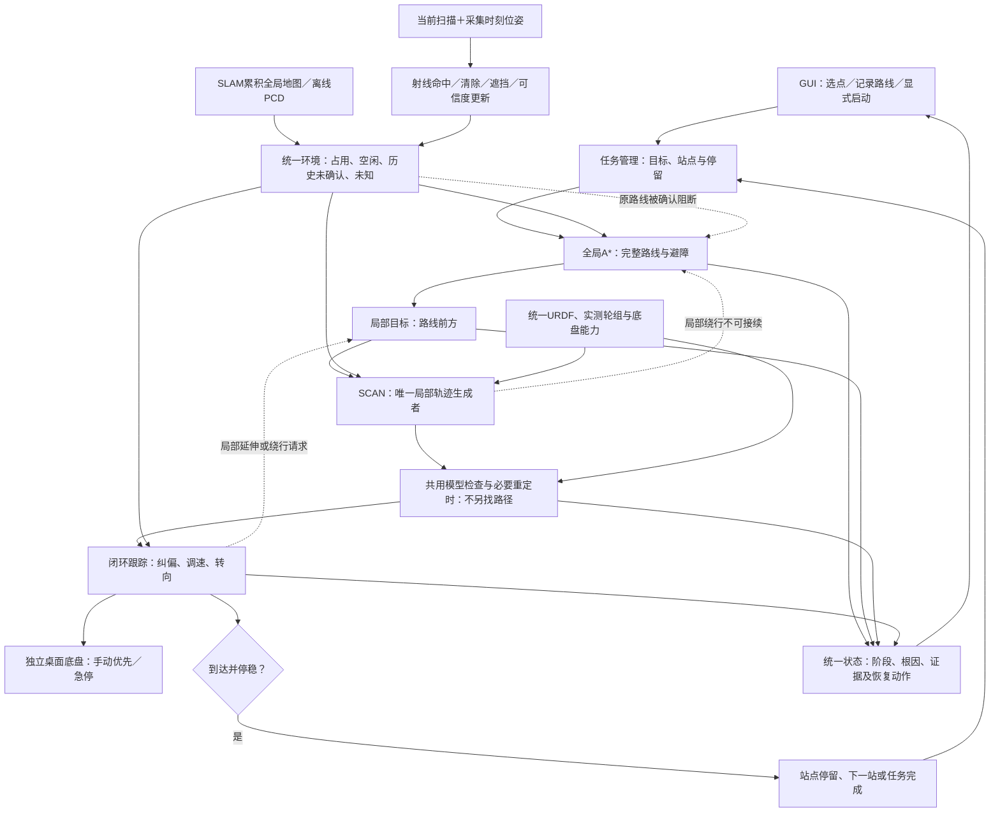

# R2导航系统架构与代码整理方案

状态：**2026-11-18七次修订（文档待审）：清理旧概念，局部范围按雷达（§3.9），持久全局地图+脏段重搜（§3.10），并收敛为§3.11四类约束。** 盲区归建图，导航不推断未知；无明确障碍即可通行。 未观测格不进入代价、不减速、不停车；执行侧取消观测覆盖门控，只保留实测障碍与数据断流检查；不设探索式改道；不可达判定前必须先局部绕行、再全局重规划。已实施项标注在第3.4/3.5节；未实施项不得当作现状。S1～S5主链已有代码迁移，现场地图融合与原因回传缺口仍按本方案修正。

## 1. 范围与优先级

依据工作区原件《N-01导航算法需求规格说明书_优化版_20261017.docx》第1.3、2.1、4、5、7章。以下方案于2026-11-17按用户反馈修订；区分已有主链、待修正行为及待验收指标，不把源码接入等同于可用性闭环。

目标：使用甲方真实地图、定位、传感器和底盘能力，实现全局规划、实时局部导航、动态避障及阻断恢复；输出符合底盘能力的车体速度。工程界面和记录路线辅助联调，不能抵扣核心导航要求。

| 需求 | 本轮必要优化 | 完成依据 |
|---|---|---|
| NAV-02、OBS-01 | 新障碍及时进入环境，保留影响通行的低矮/悬空物体；共用地面与占用规则 | 固定障碍和临时物料场景中的障碍/风险及轨迹记录 |
| NAV-01、MOT-01/03 | 修复起步碰撞误判，区分真实障碍、地面、自身回波和包络姿态；按实际全向能力规划 | 有效起终点可规划，真实碰撞仍被识别 |
| OBS-02 | 障碍出现时调整路径/速度，移开后继续原任务 | 避让、恢复和最终到达完整闭环 |
| REC-01、SAFE-01 | 局部绕行→必要时全局重规划→不可恢复时等待/停止，环境恢复后重新判断 | 三种阻断场景均有明确结果，不能只证明能停车 |
| PERF-01/02/03、MOT-02 | 记录规划耗时、任务成功率、连续运行和实际速度 | 原指标500ms、8h、95%、≤1.0m/s；统计细节待确认 |

实施顺序：先完善现有环境层的命中/空闲/未知及历史融合，解决近处过滤和旧障碍反弹；再统一规划碰撞查询与起步姿态，补齐绕行/恢复；最后完成需求场景和性能验收。动态场景功能不因高级跟踪模块未引入而推迟到交付之后。

最小改动范围：保留A*、SCAN和统一导航跟踪；在GridMap/感知适配中改进环境维护，不新接另一套地图与规划系统。URDF自身过滤、局部分区地面和时序置信度是候选实现手段，不是新增合同交付项；按解决缺陷所需选用，不预设必须安装STVL、Patchwork++或nvblox。复杂表面重建、物体语义识别及完整轮控不属于本轮核心。

甲方负责建图定位、地图管理、传感器接口和底盘驱动。乙方负责基于有效输入的环境风险、轨迹、车体速度及导航恢复。四轮目标转角、驱动轮速、舵机同步和电机补偿由甲方底盘执行；乙方读取反馈验证指令可行性，不另外控制四轮。甲方共享预处理、安装参数或底盘异常按接口问题协同处理，不直接改动运行中的桌面组件。

## 2. 源码审查依据

- 参考包：`/home/demo/lyy/r3_scan_sim_FULL_20261113.zip`，已读取实际源码，未执行包内脚本。
- 原文件和哈希：`/home/demo/lyy/n01_runtime/reports/r3_reference_review_20261115/`。
- 当前基线/61个Python模块清单：`/home/demo/lyy/n01_runtime/reports/architecture_baseline_20261115/`。
- 迁移前监视器会屏蔽SCAN或另做heading搜索；这两处分叉已删除。
- 旧Python导航执行器已由C++统一控制替代；GUI移动循环的位姿否决与独立转向流程已删除。
- 当前默认launch保留感知、SCAN、准入、显示和诊断；不启动Path审批拼接或影子跟踪，不自动启用底盘输出。

参考包中值得复用：A*→SCAN→闭环控制的交付关系，样条速度前馈、位置/航向反馈，大航向误差时冻结轨迹进度，集中配置和启动入口。

禁止照搬：R3固定抬高/双圆柱参数、直接积分速度的仿真底盘、允许横移/倒车的默认控制律、以先验地图替代实时感知、按进程名广泛杀节点。其控制器只记`have_odom`，没有过期治理，且每次轨迹消息都重置进度。包内Python A*还有`load_world`将地图偏移参数`off`覆盖为文件偏移整数后再解包的代码缺陷。参考包仿真成绩不作为R2实机结论。

## 3. 目标主链



唯一局部轨迹来源、唯一任务目标、唯一执行进度、唯一正常导航速度输出者、唯一物理模型来源保持不变。这些是职责边界，不新增另一套ROS地图/规划节点或一层运动许可。

### 3.1 全局与局部的融合规则

实时模式的全局背景是本次SLAM累积地图，离线模式是加载的PCD；局部窗口是处理范围，不是已观测证明。全局A*、SCAN、轨迹检查和控制使用同一环境状态及机器人模型的相应视图，不再各自决定同一个障碍是否存在。

| 区域／证据 | 规划语义 |
|---|---|
| 局部范围外、已建图且未被有效更新 | 按全局地图正常避障，不以“以后可能移走”为由穿越 |
| 局部范围内、新鲜有效命中 | 形成实测障碍，影响全局和局部；按来源质量处理孤立弱回波，不能每个模糊点立即成为永久硬占用 |
| 实际射线穿过旧占用并到达后方／地面 | 在实际经过的三维体素积累反证，确认后清除旧占用；不清整列或遮挡后方 |
| 局部范围内、历史占用长期未确认 | 可信度可下降为历史未确认风险；不得永久以过期硬占用与新占用简单取并集，也不直接宣称空闲 |
| 遮挡／无有效回波 | 不产生空闲证据；保留历史与来源质量，不能用窗口空白覆盖；也不能刷新旧命中的有效期 |
| 从未建图（盲区） | **不构成障碍**：只有实测命中与静态地图点才不可通行；盲区不参与清除、不生成空闲证据、不作到达或失败依据。执行侧不因未观测停车 |

确认清除、重新命中、来源时间和世界坐标必须跨局部窗口移动保存；同坐标系的新SLAM累积快照不能无条件复活已清除的旧障碍。有效更新按实际观测时间解决冲突，不按消息到达先后。重新命中可恢复占用；地图／坐标会话变化则重置证据，不复用旧路线权限。

融合不是“整个局部方框覆盖全局”，也不是“历史障碍＋当前障碍永远取并集”。有效命中增加占用，真实清除减少占用，长期未确认降低质量；仅超时不等于真实清除。窗口外已经确认更新过的区域沿用更新结果，不因离开窗口而恢复原PCD。

### 3.2 残留障碍、遮挡与不确定性

每个相关世界体素保留占用证据、最后命中／真实穿越时间、观测质量、历史来源和清除版本。证据状态至少区分实测占用、确认空闲、历史未确认和未知，可信度与物理占用不要混成同一布尔值。

1. 清除依据是实际射线路径，允许多帧积累，不能要求同一格每帧出现或一次短暂缺帧就撤销有效空闲。地面射线只清它经过的高度，不删除上方椅面、护栏。
2. 历史占用的衰减不等于删除。结合来源可靠性、观测机会与历史证据，局部长期未确认项退出永久确定占用，进入有代价、有来源的风险层；全局可寻找替代路线。不能只因窗口滑到某处或一帧没扫到，就立即软化该处全部地图障碍。当前仍被有效命中支持的障碍不因时间自动消失。
3. 窗口外已建图障碍不因当前雷达看不到而自动降级。窗口内遮挡不冒充可见，不凭“应该看见”强行生成空闲射线。持续存在的可靠历史证据与短暂噪点应有不同记忆行为；不以物体语义识别为实现前提。
4. 导航不做"未知可能被占"的推断：未观测格不进入代价、不触发减速或停车，只按明确障碍（实测命中、静态地图点、动态预测点）规划。执行侧按实测障碍与制动走廊校验，不要求观测覆盖；盲区、玻璃、负障碍与遮挡由甲方建图与传感器布置负责，相关责任按OPEN-07书面确认。
5. 旧风险影响通行时必须可见、可追溯、可恢复；禁止“过期但永久阻挡、又不告诉用户为何不能清除”的状态。动态预测另列短时风险，不写入实测占用、不用预测点清除地图；可信度不足优先改变代价与速度，不能因一次预测把整条路线永久封死。

不在此新增统一的衰减秒数、命中次数或速度阈值。3秒覆盖TTL、0.6秒场景时效仅用于诊断，不作为通行许可；模糊命中仍按证据质量处理，不因"不确定"整体封路。

### 3.3 全局路线、局部调整与持续执行

- 全局规划直接采用融合环境：近处按实时证据修正，远处按有效全局地图避障。取消“只因进入窗口就把所有历史障碍降为倍率12软代价”的规则。
- A*折线、抽点和平滑后的最终已知路线均保持避障；抽点／平滑破坏避障时回退至有效折线或受约束平滑，不发布穿障曲线并宣称规划成功。这属于路径生成正确性，不增加独立审批链。
- 全局参考直接穿过未观测区域，不标注探索段、不因缺少观测改道；只有实测确认原路线不可通行时才重规划。目标参考已生成、局部轨迹可执行、已经到达是三种结果，不能混报成功。
- 地图更新若不影响当前路线则保持；影响近处时SCAN调整当前段并保持后续任务；确认阻断或局部不能接回时触发全局重规划，不必须先失败固定次数。不同等价绕行不因每帧更新而换边。
- 不设探索式改道：原全局路线被实测确认阻断且局部无法接回时，只做局部绕行或全局重规划，不另选"探索前沿"。前沿搜索代码已于2026-11-17删除，生产链不再包含该路径。
- 新段计算中续用当前仍有效的执行段；根据剩余可验证距离调速、提前延伸，确实无法接续时停车并报告根因，不先清空有效路径再等待。

### 3.4 约束变更必须披露

新增、收紧、恢复或改变约束适用范围，都必须在实施前后如实报告：作用模块、旧／新规则或阈值、来源（物理／策略／经验）、必要性、可能减少成功率的场景、可降速／软代价替代方案、验证证据和回滚配置。移动限制与搜索资源预算分别记录；不能将“稳定性优化”当作隐含增加门槛的理由。

| 本次决策 | 性质与预期影响 | 当前状态 |
|---|---|---|
| 窗口外已知障碍正常避障；近处依证据更新 | 纠正全局语义，会拒绝当前错误放行的穿障路线 | 待实现与回归 |

| 残留占用降质、真实清除跨全局生效 | 减少历史与实时重复堵路，不将未知直接称为空闲 | 待实现与场景验证 |
| 平滑保留避障及回退有效折线 | 算法正确性，避免A*成功而曲线切角；不新增审批模块 | 待实现与回归 |
| 动态预测风险只降速、不封路 | 预测不冒充实测占用，0.5倍速度建议保留 | **2026-11-17已实施**；未观测不再参与降速 |
| 未观测格不构成障碍（规划与执行） | 取消"未知可能被占"的推断，成功率上升；盲区风险移交建图与OPEN-07 | **2026-11-18已收敛**：覆盖门控整条移除；未知可通行只由建图负责，导航不再回滚旧门控 |
| 目标受理：只拒绝已知占用与超预算；地图外接受且无额外推进限制 | 与"无明确障碍即可通行"一致，不再需要谨慎推进许可 | **2026-11-17确定**；`goal_occupied`保留 |
| 不设探索式改道 | 未知不再触发改道，路线更稳定 | **2026-11-17已移除前沿代码**；旧`max_replan_fail_count`兜底同时删除，恢复只走三级阶梯 |
| 离线模式全局搜索边界扩展到目标 | 地图外目标可规划 | **2026-11-17已实施**：`grid_map.extend_reference_to_goal: true` |
| 反馈时效改为声明参数（位姿/速度/轮组/包件/场景/到达停稳） | 原硬编码改为可调，默认统一为 3.0 s（2026-11-17 现场要求）；放宽属于安全取舍 | **2026-11-17已实施**：`feedback.*`、`arrival.confirm_s`、`perception.observed_free_max_age_s`、`perception.body_pose_max_age_s`，默认3.0 s，范围0.1–5.0（body_pose 上限5.0），运行时读取 |
| 我方参数集中管理（GUI） | 只管理本仓库节点，不含甲方 | **2026-11-17已实施**：参数注册表+导航页“参数管理”面板，标注立即/重启生效 |
| 低耗占据栅格显示 | 显示专用二维投影，不参与规划；空闲/未知分色 | **2026-11-17已实施**：`/grid_map/reference_grid`、`/grid_map/live_grid`，5cm，GUI默认低耗栅格，细节模式保留点云 |
| 旧概念清理 | 移除死路径，行为不变 | **2026-11-18**：删除前沿、旧失败计数；覆盖门控/双圆柱/12×未确认/重复时效按下表清理，详见§3.11 |
| 历史未确认代价参数化（现值12） | 可按现场标定或等效关闭 | 待实施 |
| 动态避让恢复判定（清除条件、滞回、归位、证据） | 把"降速后自动恢复"升级为可判定的恢复事件，减少抖动并留验收证据 | 待实施（§3.7） |
| 碰撞、真实轮组能力、控制权及急停 | 既有物理／控制边界，统一复用，禁止多层另设不一致阈值 | 保留；本次不扩大范围 |

本次代码对齐不新增曲率、转角、定位或场景时效硬门槛。新增预测软限速比例0.5及基于已验证前段的制动速度上限；300000个全局曲线采样为计算预算，超预算回退A*有效折线，不是一条新的实机运动许可。窗口内已知占用恢复避障会撤销原来错误放行的路线；所有变化均须验证并披露。

### 3.5 目标受理与不可达判定（2026-11-17 按甲方口径修订）

目标受理以甲方提供的地图为规划依据（IF-01），并保证"有效起终点"可追溯（NAV-01）：

| 目标状态 | 受理 | 行为 | 结果 |
|---|---|---|---|
| 格式、坐标系、有限值、取消/重发合法，位于已知地图范围内，且不落在已知占用 | 接受 | 全局A*按"已知障碍避障、地图内未观测格按无点即自由"生成参考 | 正常执行 |
| 落在**已知占用**区域 | 拒绝 | 不生成穿障路线 | `goal_known_occupied` |
| 位于**已知地图范围外** | 接受 | 无明确障碍即可通行；不设额外推进限制 | 正常执行 |
| 超出全局搜索资源预算 | 拒绝 | — | `goal_beyond_search_budget` |

不可达判定与恢复顺序按REC-01/SAFE-01/TC-06：

1. 目标进入局部窗口后被实测占用或路径被阻断，**先局部绕行**；绕行不可接续时**再全局重规划**。
2. 两者都失败才判定不可恢复，进入**等待或安全停止**（零速），报`goal_unreachable_observed`；保留原始目标与goal_id，不自动改目标、不沿路线回退、不宣称到达。
3. 现场条件恢复或用户处置后可从同一目标继续，不把"等待"写成"任务终止"。

"参考已生成""局部轨迹可执行""已到达"三种结果分开报告。未观测不构成失败理由，也不构成到达理由；地图外目标不因缺少地图证据被拒绝，按可通行处理。

失败判定恢复REC-01的绕行/重规划前置条件、以及已知占用目标拒绝，是NAV-01[122]与SAFE-01的明文要求。**地图外与盲区不构成拒绝理由**：需求书未出现"地图外/未知/探索"表述，[102]将"可执行目标"定义权交给算法方；导航不推断盲区，只认明确障碍。该边界需通过IF-04/OPEN-05与甲方补确认，安全责任按OPEN-07约定。

待确认：失败是否计入PERF-03（OPEN-01）、受理≠可达的接口表述（OPEN-05）、500ms统计起止点（OPEN-02）。

#### 3.5.1 有界恢复阶梯与运行时调整（2026-11-17）

失败恢复按固定顺序有界执行，避免"一失败就停"和"无限重试"两种极端：

| 阶段 | 动作 | 次数参数 | 状态 |
|---|---|---|---|
| ① 局部绕行 | 保留全局参考，SCAN 重规划当前段 | `recovery.local_attempts`（默认15） | `RECOVERY_LOCAL_DETOUR` |
| ② 全局重规划 | A* 从实测位姿重算参考 | `recovery.global_attempts`（默认5） | `RECOVERY_GLOBAL_REPLAN` |
| ③ 等待/安全停止 | 零速、保留目标与goal_id | 直到操作员继续或`recovery.wait_timeout_s`到达 | `WAITING_FOR_CLEARANCE`/`goal_unreachable_observed` |

- 成功规划或新目标会重置阶梯；同一次失败不会重复计数。
- 阶段③ 的解除方式：操作员在 GUI 点"继续任务"（`/n01/navigation/resume`）、下发新目标，或等待超时且`recovery.auto_resume`为真。
- 阶梯逻辑抽为可单测头文件 `navigation/recovery_ladder.hpp`，FSM 只负责动作。
- **运行时调整**：三个参数由规划节点实时读取，GUI"恢复策略"面板通过标准 `SetParameters` 写入，无需重启；写入不影响运动使能、底盘或安全门控。

### 3.6 无明确障碍即可通行（2026-11-17 五次修订，已实施）

导航不推断盲区。盲区、遮挡、玻璃、负障碍与地图外区域属于甲方建图、地图管理与传感器布置的职责；导航只回答"有没有明确障碍"。

判定规则只有一条：**存在明确障碍则不可通行，否则可通行。**

"明确障碍"的唯一定义：静态地图点（有效高度带内）、当前实测命中（含累积与膨胀）、动态预测点（短时风险层）。除此之外的格子——未扫描、被遮挡、地图外、稀疏缺失——一律不作为障碍，不进入代价，不触发减速、等待或改道。

| 层 | 旧行为 | 新行为 |
|---|---|---|
| 全局A* | 未观测可通行（已实施） | 不变 |
| SCAN 局部 | 未观测可通行（已实施） | 不变 |
| 执行前缀 | 要求已验证覆盖，覆盖尽头停车 | **取消**：只按实测障碍与制动走廊校验 |
| 速度 | 覆盖不足时按前缀长度限速 | 只按实测障碍距离、制动能力与配置限速 |
| 前沿/探索 | 覆盖边界选前沿 | **已删除**（2026-11-17）：不因未知改道 |
| 状态原因 | `scan_footprint_enters_unknown_space`等 | 只保留数据断流、实测碰撞、求解失败 |

保留的数据门控（与盲区无关）：点云、位姿、底盘反馈、场景超时仍停车。传感器断流属于输入失效，不是盲区，不能借"盲区不推断"绕过。

责任边界：盲区、玻璃、负障碍（坑洞、台阶）及遮挡背后的空间由甲方建图与传感器布置负责，导航不因其未观测而停车或绕行。该边界需按OPEN-07与甲方书面确认；确认前不得将其宣称为已验收能力。

覆盖门控已从当前方案移除，不再提供回滚开关；未知由建图负责，导航只按明确障碍拦截。

### 3.10 持久全局地图与脏段重搜（2026-11-18 提案，待审）

**问题**：当前全局 A* 已使用完整静态源，但实时观测只活在 10 m 窗口内；全局路径一旦生成，只有“整条被挡”才重算，无法表达“只修正某一段”。

**目标**：全局地图持久化并持续增量更新；全局路径默认固定；新观测只触发受影响段的局部重搜。

#### 3.10.1 双地图

| 地图 | 范围/分辨率 | 用途 |
|---|---|---|
| 全局 2D 占据栅格 | ±100 m，0.10 m | 全局 A*、脏段判断 |
| 局部 3D 体素 | 雷达范围（30 m），0.10 m | SCAN 碰撞、局部避障 |

全局 2D 只做 2D 投影，不做 3D 精细碰撞；局部 3D 不写回全局，只有“段级结果”回写。

**与 SCAN 的职责边界（为什么还需要段内 A*）**：

| 问题 | SCAN 局部规划 | 段内 A* |
|---|---|---|
| 前方 2–5 m 出现行人/箱子 | ✅ 重优化 B 样条绕开 | 不需要 |
| 局部通道变窄、曲线不可行 | ✅ rebound/refine；失败则报局部失败 | 视情况 |
| 20 m 外走廊被新观测堵死，需要换走廊 | ❌ 看不到、也改不了全局参考 | ✅ 只重搜该段 |
| 全局参考本身穿墙/被新地图否定 | ❌ 局部目标仍在错误参考上 | ✅ 修正参考段 |
| 全局路线大部分仍有效，只有一段脏 | ❌ 只能反复局部绕或整条重算 | ✅ 段级修复 |

SCAN 是"全局参考的执行器"：它在局部窗口内把参考变成可执行曲线，能绕近处障碍，但**不持久化地图、不改变全局路线拓扑、不负责远端段的有效性**。段内 A* 是"全局参考的维修工"：只修被新观测否定的那一段。两者是上下游关系，不是替代关系。

如果没有段内 A*，当前只有两条路：SCAN 反复局部绕（绕不过就卡住），或整条全局重规划（丢稳定性、代价大）。段内 A* 是中间层。

#### 3.10.2 全局地图更新规则

| 事件 | 全局 2D 动作 |
|---|---|
| SLAM `/cloud_map` 新增/更新 | 按版本写入静态占用；不覆盖更新的实时空闲 |
| 实时命中 | 置占用，记录时间戳与版本 |
| 实时射线穿过 | 连续 N 次（建议 3）确认后置空闲，清除静态占用 |
| 动态目标离开 | TTL 到期后转空闲 |
| 未知 | 保持未知；A* 按可通行 |
| 冲突 | 实时证据优先于 SLAM 静态；旧版本不得覆盖新版本 |

每个格子维护 `value(-1/0/100)` 与 `version`；用 2 m tile 汇总版本，避免逐格比对开销。

#### 3.10.3 全局路径与脏段

- 全局路径按 0.3 m 采样；每个采样点记录其走廊覆盖的 tile 版本；
- 脏段检测：沿路径检查走廊（足迹+6 cm）内 tile 版本是否变化；变化则标记 `[i,j]` 为脏段；
- 检测频率 2–5 Hz，或在全局 2D 更新事件后增量触发；
- 新目标、起点偏离路径、脏段过多（>50%）时退回整条全局重规划；
- 全局路径发布保持不变，新增“段版本/脏段”诊断字段。

#### 3.10.4 段内重搜

1. 取脏段前后最近的**有效锚点** A、B；
2. 在包住 A→B 的有界窗口内跑 A*（含足迹与 6 cm 余量）；
3. 成功：替换该段，重新平滑该段并与前后段做航向/速度衔接；
4. 失败：向两侧各扩一段再搜（最多 2 次）；
5. 仍失败：整条全局重规划；
6. 仍失败：进入恢复阶梯（局部→全局→等待）。

#### 3.10.5 局部绕行回写

局部 SCAN 成功绕开某段后，把实际执行曲线（或 0.3 m 重采样折线）替换对应全局段，并写入当前 tile 版本。这样下次不需要重复绕行，全局路径也会随现场“边走边更新”。

#### 3.10.6 参数与预算（建议）

| 参数 | 建议值 |
|---|---|
| 全局 2D 范围/分辨率 | ±100 m / 0.10 m（约 4 MB） |
| 路径采样间距 | 0.30 m |
| 走廊宽度 | 足迹 + 6 cm |
| 脏段检测频率 | 2–5 Hz |
| 段扩展次数 | ≤2 |
| 实时清除确认 | 连续 3 次 |
| 全局重规划退化阈值 | 脏段 >50% 或段搜失败 2 次 |

#### 3.10.7 验证要求

- 场景：全局路径固定后，在 20 m 外放置/移走障碍，确认只重搜对应段，A* 调用次数与段数可计数；
- 连续性：替换段前后航向/速度连续，无原地抖动；
- 稳定性：同一障碍反复出现/消失时，脏段不来回震荡（滞回/确认）；
- 内存/CPU：全局 2D 更新与脏段检测的周期耗时可测；
- 回滚：关闭持久全局层即回到“静态全图 + 窗口实时”的当前行为。

**状态**：2026-11-18 已实施第一版：GridMap 持久全局 2D 层（静态+实时命中 TTL 10 s+观测空闲，2 m tile 版本）、全局 A* 改吃该层、脏段检测+段内 A*+扩段+超 50% 整条重规划。局部绕行回写尚未实施；现场内存/CPU/脏段行为待验证。

### 3.11 旧概念清理与当前方案收敛（2026-11-18）

以下概念在历史版本中出现过，但与当前"未知可通行、持久全局地图、雷达范围局部图"的目标不一致，**从当前方案中移除**；历史验证记录保留在 validation。

| 旧概念 | 处置 | 当前替代 |
|---|---|---|
| 探索前沿/前沿选择 | **删除**（代码与方案） | 不因未知改道；全局路径固定，脏段重搜 |
| 观测覆盖门控（`require_observed_space`、`observed_free`、`not_observed`、`observed_space_stale`） | **移除** | 未知可通行；只保留数据时效与实测障碍 |
| 双圆柱足迹兜底 | **移除** | 只保留 URDF 足迹 + 6 cm 余量 |
| 12× 未确认软代价 | **不采用** | 静态/实时硬障碍；未确认不再加价 |
| 四套重复时效（桥接/监视器/控制器/监督器） | **收敛** | 监视器与控制器两处权威判断；桥接只做内部一致，监督器只读展示 |
| 跳变阈值 2 m + 2 s 自动重锚并存 | **合并** | 只保留自动重锚（有限频次），不设永久硬锁 |
| 三套重规划触发（剩余时间/偏离/到点） | **合并** | 剩余时间 + 偏离两条；到点只做停稳确认 |
| 旧 `max_replan_fail_count` 兜底 | **删除** | 恢复只走局部→全局→等待三级阶梯 |
| CBF 可选模块 | **不采用** | 动态障碍仅预测降速 + 实测避障 |
| 固定 10 m/5 m/12 m 人为限制 | **按 §3.9 调整** | 局部范围按雷达有效距离，射线/点距同步放大 |

**当前方案只保留四类约束**：

1. 几何安全：URDF 足迹 + 6 cm、机身 z 带、实测/静态硬障碍；
2. 运动安全：速度/加速度上限、急停、手动接管；
3. 数据有效：监视器/控制器各一处时效判断；
4. 恢复顺序：局部 → 全局 → 等待。

**状态**：2026-11-18 第一阶段已实施：12× 未确认代价归 1、生产配置移除覆盖门控/双圆柱参数、GUI 移除覆盖时限条目；§3.9 局部范围扩到 30 m/0.10 m；§3.10 全局 2D 持久层与脏段重搜第一版已实施。覆盖门控/双圆柱的**代码函数**、重复时效合并、跳变策略合并、局部绕行回写仍待实施。

### 3.12 目标朝向与终点足迹检查（2026-11-18 提案，待审）

**现状**：GUI 有“目标 yaw”输入，但单点导航的 yaw 基本不参与规划与到点判定；目标占用检查用当前机身朝向，终点足迹范围在 GUI 上不可见。用户无法判断“目标点摆下车体会不会压障碍”。

#### 3.12.1 目标表示

- 目标 = `(x, y, z, yaw)`，不再只是点；
- GUI 交互：地图**点击定位置 + 拖动箭头定朝向**；保留数值输入，单位明确为 **deg**；
- 地图上画箭头表示朝向，箭头根部为 `(x,y)`。

#### 3.12.2 终点足迹检查

- 足迹 = URDF 碰撞几何投影多边形 + **6 cm** 环境余量，不是圆、不是路径；
- **起点**检查：机器人当前位姿 + 当前朝向；
- **终点**检查：目标点 + **目标 yaw**（不再被 `fixed_body_heading` 覆盖）；
- 检查范围：足迹多边形覆盖的所有格；任一点命中静态/实时硬障碍即拒绝；
- 未知格：按可通行；目标点中心占用与足迹边缘占用分别报原因：

| 原因码 | 含义 |
|---|---|
| `goal_occupied@(x,y)` | 目标中心格占用 |
| `goal_footprint_occupied@(x,y,yaw)` | 目标点空，但足迹边缘/角点压障碍 |
| `goal_outside_map` | 目标超出可扩展范围 |

- 手动目标：拒绝并保留目标；自动目标：沿全局路径回退到最后一个足迹无碰撞点。

**朝向开关（2026-11-18 修订）**：GUI 只保留一个“设置朝向”开关，取代原来的“目标 yaw + 到点朝向”两个控件。

| 开关 | 目标 orientation | 终点足迹检查 | 到点朝向 |
|---|---|---|---|
| **关（默认）** | 发送**选点那一刻冻结**的机身 yaw | 按冻结 yaw；之后不随车转 | 不强制，跟随路径切线/对齐 |
| **开** | 发送输入 yaw（deg） | 按输入 yaw | 强制 ±6° |

关闭时不再把默认 0° 当成“朝东要求”，避免目标本身空、但 0° 足迹角压障碍被误拒。

#### 3.12.3 规划与控制的改动

1. 全局 A* 目标格膨胀按 **goal yaw**；
2. `adjustGlobalTargetIfOccupied` 传入 goal yaw，不再用当前朝向；
3. 轨迹包携带 `goal_yaw`；单点目标如设置朝向，则 `require_final_yaw=true`；
4. 到点朝向容差 **±6°（0.105 rad）**，可由参数调整；
5. 起点包络仍用当前朝向，避免起步误判。

#### 3.12.4 GUI 预览

- 在目标点绘制**半透明虚拟 URDF 机器人**（当前关节姿态），按目标 yaw 摆放；
- 颜色与足迹检查一致：绿=可停、红=压障碍、灰=未知；
- 同时画到点允许误差：位置 8 cm、朝向 ±6°，避免"点得下但停不准"；
- 足迹多边形仍保留，作为虚拟机器人的外扩包络参考。


- 终点画足迹多边形（按 goal yaw 旋转）、外扩 6 cm；
- 颜色：
  - 绿色：足迹内无静态/实时占用；
  - 红色：足迹内含障碍；
  - 灰色：足迹内为未知（可通行，但提示未观测）；
- 旁边显示 z 带与拒绝原因；
- 明确区分“路径碰撞”和“终点足迹碰撞”：路径线碰撞是整条路线检查，足迹框只检查到点那一刻车体摆位。

#### 3.12.5 路径失效与 A* 输入一致性（修正项）

- 全局 A* 规划前**强制重建**持久全局层，日志输出 `source=persistent_global/static_fallback`；
- 地图版本变化且目标未执行时，全局路径标记为 stale；GUI 画灰/虚线或隐藏；
- 目标结束/取消时清空全局路径引用；
- 路径显示携带 stamp 与“历史参考”标识，避免旧路径被误认为当前规划。

#### 3.12.6 障碍判定与路径像素审计

**规划器眼里的障碍只有三类**：

| 层 | 数据 | 是否硬障碍 |
|---|---|---|
| 静态层 | PCD / 实时 `/cloud_map`，地面+3 cm 以上 | 是 |
| 实时层 | `/cloud` 射线更新的命中体素，3 s 内 | 是 |
| 动态预测 | 0.25/0.5/0.75 s 预测点 | 否，只降速 |

限定：机身 z **−0.25~+0.90**、URDF 足迹 **+6 cm**、未知格（-1）**可通行**。

**路径像素审计**（用于判断“是否真穿障”）：

1. 路径按 0.05 m 采样，取**中心线**，不比线宽；
2. 每个采样点用足迹多边形+6 cm 扫掠，不是只查中心点；
3. 路径与栅格必须**同一时间戳/同一地图版本**；
4. 使用**规划高度带**的栅格，不用 GUI 显示带；
5. 输出：首个碰撞点坐标、层（静态/实时）、最近距离，以及“显示有/规划无”的差异格。

判定：

| 审计结果 | 结论 |
|---|---|
| 同一时刻、规划栅格内足迹命中 | 真穿障，查 A* 输入/膨胀 |
| 显示栅格命中、规划栅格不命中 | 高度带/回退/版本不一致 |
| 两者都不命中 | 视觉线宽、旧路径或坐标误差 |

**常见“看起来穿障”的原因**：旧路径、A* 回退到静态源、显示带比规划带高、0.1 m 分辨率+6 cm 的薄障碍、线宽/像素误差、未知区可通行。

#### 3.12.6 验证

- 目标中心空、足迹角点压障碍：必须拒绝并报 `goal_footprint_occupied`；
- 目标在未知区：允许，预览为灰；
- 设置 yaw 后：全局目标膨胀、终点足迹、到点朝向均使用同一 yaw；
- 未执行时地图更新：旧路径变灰/失效，不显示为当前路径；
- 录像对比：同一目标不同 yaw 的足迹框与接受/拒绝结果。

**状态**：2026-11-18 方案确认并完成：规划器解析 goal yaw、终点足迹检查（URDF+6 cm、未知放行）、`goal_footprint_occupied`；控制器 `final_yaw_tolerance_rad=±6°`；GUI 单一“设置朝向”开关、yaw 箭头、终点红/绿/灰足迹、**目标点半透明虚拟 URDF 机器人 + 8 cm 到点误差圈**；新目标/地图变化时全局路径失效。**已实施**：终点足迹红/绿/灰多边形预览（URDF+6 cm，未知灰）。**未完成**：地图点击+拖动箭头、路径像素审计叠加层。

### 3.13 故障域归因（2026-11-19 提案，待审）

**目标**：规划/执行卡住时，不只报“失败原因”，还要指出**主责域**：地图质量、定位质量、规划、执行、底盘、感知、配置、人工操作，避免把地图问题误判成算法问题。

#### 3.13.1 输出字段

`/planning/status` 增加：

| 字段 | 含义 |
|---|---|
| `reason` | 立即原因码（保持现状） |
| `fault_domain` | 主责域（单值） |
| `fault_domains` | 候选域及置信度（可多值） |
| `fault_evidence` | 判定证据（图层、坐标、时效、最近距离等） |
| `fault_action` | 建议动作 |

#### 3.13.2 域定义

| 域 | 含义 | 典型原因 |
|---|---|---|
| `map` | 地图/静态层/占用图/目标格 | `goal_occupied`、`goal_footprint_occupied`、`start_occupied`（静态）、`global_no_route`、`map_reference_unavailable`、`static_pcd_*` |
| `localization` | 位姿、TF、重定位、扫描对齐 | `localization_*`、`global_robot_pose_*`、`pose_scan_*`、`body_pose_*`、`odom_*`、`scan_motion_compensation_*` |
| `perception` | 激光/点云/地面/场景 | `scene_not_ready`、`ground_*`、`occupancy_stale`、`live_*` |
| `planning` | 全局/局部搜索、优化、轨迹生成 | `global_search_budget_exceeded`、`global_reference_collision`、`scan_optimizer_*`、`scan_no_solution` |
| `execution` | 轨迹包、场景准入、跟踪、纠偏 | `packet_*`、`scene_or_admission_stale`、`corrected_command_*`、`WAITING_FOR_REPLAN`、`feedback_*` |
| `chassis` | 底盘/急停/轮组/原生模型 | `estop`、`manual_override`、`wheel_*`、`chassis_twist_stale`、`native_ik_fk_*`、`live_wheel_*` |
| `config` | URDF/包络/参数/接口配置 | `urdf_footprint_*`、`invalid_global_inputs`、`packet_geometry_*` |
| `operator` | 人工停止/取消/目标非法 | `user_stop`、`goal_invalid`、`manual_stop` |
| `unknown` | 数据不足，禁止猜测 | 无状态、无日志、原因码未登记 |

#### 3.13.3 归因规则

1. **先看硬证据，不看文案**：位姿/时效/TF → 定位；地图版本/占用格/目标格 → 地图；包件/反馈/纠偏 → 执行；急停/轮组 → 底盘。
2. **主因 + 次因**：例如 `start_occupied` 同时给 `map`（静态/实时占用）和 `localization`（位姿与足迹不一致）候选，置信度标明。
3. **数据不足时 `unknown`**，不得把“没收到数据”归因成算法错误。
4. **同一原因在不同阶段可换域**：`goal_occupied` 在规划阶段归地图，若位姿跳变导致则定位为次因。
5. 所有归因必须带证据；无证据的猜测不写入。

#### 3.13.4 GUI

- 失败/暂停提示统一显示：`[主因：地图] 目标在膨胀障碍内 ...`；
- 展开事实区显示：图层、坐标、最近障碍距离、位姿时效、地图版本；
- 颜色：地图=蓝、定位=紫、感知=青、规划=黄、执行=橙、底盘=红、配置=灰、人工=白；
- 未知显示“数据不足，先查日志/话题”，不显示具体域。

#### 3.13.5 验证

- 每个已知原因码至少映射一个域；
- `start_occupied` 在“全局旧点/局部真实障碍/定位跳变”三种场景下能给出不同主因或证据；
- 无数据场景必须为 `unknown`；
- GUI 文案、状态 JSON、日志三处一致。

#### 3.13.6 证据字段（`fault_evidence`）

每个失败/暂停必须携带可复核证据，不写“猜测”：

| 域 | 必填证据 |
|---|---|
| map | 地图版本/时间戳、图层（静态/实时/全局）、目标格值、最近障碍距离、涉及坐标 |
| localization | 位姿 stamp/接收年龄、TF 年龄、reloc/fitness、扫描-位姿偏移、发布者数量 |
| perception | 扫描 stamp/年龄、地面状态、点云 frame、有效点数 |
| planning | 全局/局部耗时、搜索预算、扩展节点数、首个碰撞点 |
| execution | 包件 age、场景 age、反馈 age、纠偏指令预测位置、拒绝阶段 |
| chassis | 急停源、轮组 age、原生 IK/FK 残差、转向/速度限值 |
| config | 缺失参数名、URDF 是否就绪、包络顶点数、非法值 |
| operator | 操作类型（停止/取消/改目标）、目标坐标、时间 |
| unknown | 缺失的话题/字段名，最后收到时间 |

JSON 示例：

```json
"fault_evidence": {
  "stage": "global",
  "map_layer": "persistent_global",
  "map_version": 2,
  "start_cell": 100,
  "local_start_footprint_max": 0,
  "nearest_obstacle_m": 0.044,
  "pose_age_s": 0.08,
  "tf_age_s": 0.08
}
```

#### 3.13.7 建议动作（`fault_action`）

| 主域 | 建议动作 |
|---|---|
| map | 检查目标/起点占用与地图版本；更新 PCD 或重选目标 |
| localization | 检查定位 tracking、TF、位姿时间戳；重定位后再试 |
| perception | 检查 `/cloud`、地面、场景时效；等数据恢复 |
| planning | 放宽目标、检查窄通道/搜索预算；重规划 |
| execution | 检查轨迹包/场景/反馈；等重规划或人工挪车 |
| chassis | 释放急停/手动接管；检查轮组与底盘状态 |
| config | 检查 URDF/包络/参数/接口配置 |
| operator | 确认停止/取消/改目标是否符合预期 |
| unknown | 查日志与话题，不自动重试 |

#### 3.13.8 `start_occupied` 三场景区分

`start_occupied` 不能一律归“地图”，按证据分：

| 场景 | 证据 | 主域 | 处理 |
|---|---|---|---|
| A. 全局层旧点/拖影 | 局部起点足迹 `<=0`；全局起点格 `100`；局部最近障碍远 | map | 清全局起点膨胀或重建全局层 |
| B. 局部真实障碍 | 局部足迹 `>0`；最近障碍 `< 足迹+6 cm`；静态/实时层有值 | map（+perception 若实时） | 拒绝；挪车/清障/换目标 |
| C. 定位/足迹错位 | 局部足迹 `<=0` 但 `start` 与 `/body_pose` 偏差大；TF/位姿年龄超限；发布者冲突 | localization | 修定位/TF，不删障碍 |
| D. PCD 历史自车拖影 | 当前足迹外、历史路径附近有静态点；PCD 含车体形状 | map（数据质量） | 预处理 PCD，运行期过滤不覆盖历史 |
| E. 包络模型异常 | `footprint_missing`、顶点数异常、URDF 未就绪 | config | 修 URDF/包络 |

判定顺序：**先看局部足迹是否真的占用 → 再看全局层是否单独占用 → 再看位姿/TF → 最后看 PCD 历史**。  
A 场景可自动清起点旧膨胀；B/C/D/E 不得自动放行。

**状态**：2026-11-19 已实施第一版 `fault_domain` 与 GUI 域前缀；`fault_evidence`/`fault_action`、`start_occupied` 三场景证据为下一版实现。

### 3.14 四轮转向/驱动协同（2026-11-19 方案补充）

**轮序**：`fl=A`（左前）、`fr=B`（右前）、`rl=C`（左后）、`rr=D`（右后）。前轴 A/B，后轴 C/D。

#### 3.14.1 控制链路

```
规划输出机身 twist (vx, vy, ω)
→ 甲方 ChassisController 原生 IK（hive2_inverse）
→ 四个转向目标角 + 四个驱动转速（同时解算）
→ 转向到位/速率检查 → 驱动闭环
→ 原生 FK / screen_sequence 复核
```

规划器**不直接给四个轮子下发角度**，只给机身速度；四轮配合由甲方原生运动学统一解算，避免各轮独立决策造成“打结”。

#### 3.14.2 几何基准（甲方配置）

| 参数 | 值 |
|---|---|
| 轮半径 | 0.095 m |
| 轴距 `wheel_base_x` | 0.56 m |
| 轮距 `wheel_base_y` | 0.27 m |
| 转向偏置 `delta_y` | 0.085 m |
| 转向软限 | π rad |
| 转向速率 | 1.57 rad/s |
| 模式切换阈值 | 0.30 rad |
| 平移/自转阈值 | 0.01 m/s |

以上来自 `/opt/hivecore/hive2-motion/1.0.0/install/share/hive2_driver/config/robot_motion.yaml`；导航侧必须与控制器一致，不一致直接拒绝。

#### 3.14.3 原生 IK 的实际四轮配合

在转向角全 0 起步，查询原生 IK 得到：

| 工况 | A 左前 | B 右前 | C 左后 | D 右后 | 驱动 |
|---|---|---|---|---|---|
| 直行 | 0° | 0° | 0° | 0° | 四轮同速同向 |
| 左转 | **+54.7°** | **+30.9°** | **−54.7°** | **−30.9°** | 左 0.36 / 右 1.75 |
| 右转 | −30.9° | −54.7° | +30.9° | +54.7° | 左 1.75 / 右 0.36 |
| 原地左转 | −64.3° | +64.3° | +64.3° | −64.3° | A/C 反向，B/D 正向 |
| 原地右转 | −64.3° | +64.3° | +64.3° | −64.3° | A/C 正向，B/D 反向 |
| 横移（蟹行） | 90° | 90° | 90° | 90° | 对正后四轮同速 |

关键结论：

1. **正常左/右转时，前轴 A/B 同向**（都向左或都向右），**不是 A 向内、B 向外**；
2. **后轴 C/D 与前轴反向**（低速四轮反向相位），用于减小转弯半径；
3. **原地自转时对角配合**：A/D 一侧、B/C 另一侧，四轮切向布置；
4. 横移时四轮同向 90°，但必须**先转向到位再驱动**，否则原生 IK 驱动为 0 或拒绝。

#### 3.14.4 什么情况会“打结”

| 现象 | 根因 | 方案要求 |
|---|---|---|
| A 向内、B 向外 | 四轮角度被独立下发/符号翻转/±π 分支错 | 禁止规划器直发单轮角；只用机身 twist |
| 前轴同向但后轴也同向 | 4WS 模式配置错 | 按原生反向相位；模式切换需迟滞 |
| 转向未到位就驱动 | 初始对齐未完成 | 先 stop-and-align，再驱动 |
| 原地转时四轮同向 | 自转模式错 | 对角切向；原生 IK 解算 |
| 角度超过 ±π 回绕 | 分支连续性丢失 | 保留原生分支，不做强制折叠 |
| 轮速与转向象限不匹配 | 驱动符号错 | 由原生 IK 同时给角度+转速 |

#### 3.14.5 导航侧约束

- `four_wheel_steer_screen` 只做**必要条件筛选**，调用甲方 `screen_sequence`，不替代控制器；
- 必须检查：转向角、转向速率、轮速、横摆角速率、路径速度/加速度；
- 初始对齐作为独立停车阶段，不把对齐时间摊进路径速度；
- 规划几何与控制器几何不一致 → 直接拒绝（`navigation_geometry_mismatches_installed_chassis_controller`）；
- 监控实际四轮角：正常平移时若 `A/B` 符号相反（且非自转/横移模式），报 `wheel_pair_conflict` 并停车；
- 自转/横移模式必须有明确模式标志，不能靠角度“看起来像”。

#### 3.14.6 验收观测

- 直行：四轮 0°，同速；
- 左转/右转：前轴同向、后轴反向，内外侧轮速差正确；
- 原地左/右转：对角切向，左右轮速反向；
- 横移：四轮 90°，对正后同速；
- 记录实际转向角/轮速，与原生 IK 目标对比；偏差超阈值即判“轮组配合异常”。

### 3.15 起点包络与终点包络（2026-11-19 方案补充）

**先明确**：这里的“包络”不是路径，是**机器人本体在某个位姿下的 2D 足迹**。

```
包络 = URDF 足迹多边形（车体/腿/轮/转向）
     + 6 cm 环境余量
     + 机身高度带 z ∈ [机身−0.25, 机身+0.90]
```

#### 3.15.1 起点包络

- 位置：当前机器人位姿；
- 朝向：**当前机身 yaw**（`fixed_body_heading`）；
- 检查：`getInflateOccupancy(start, body_yaw)`；
- 失败码：`start_occupied` / `start_envelope_static_occupied` / `start_envelope_live_occupied`；
- 含义：**机器人现在站的这个位姿，车体已经压到障碍或自车点**。

起点包络不通过时，全局 A\* 不会搜索；不是“没找到路”，是“起点不可出发”。

当前处理：

1. 静态/全局层当前足迹内的自车点先过滤；
2. 全局层起点被当前自车/地面点占用 → 规划前清起点 0.40 m 膨胀（机器人物理上就在起点；局部/执行监视器继续做安全复核）；
3. 局部起点真的压障碍 → 仍拒绝，必须挪车/清障；
4. 离线 PCD 历史自车拖影 → 运行期不覆盖，需预处理 PCD；
5. 终点同理：局部终点足迹为空、全局终点格被旧点占用 → 清全局终点旧膨胀；局部终点真压障碍仍拒绝。

#### 3.15.2 终点包络

- 位置：目标点 `(x,y)`；
- 朝向：**目标 yaw**（`honor_fixed_heading=false`）；
- 检查：`getInflateOccupancy(goal, goal_yaw)`；
- 失败码：
  - `goal_occupied`：目标中心格在膨胀障碍内；
  - `goal_footprint_occupied`：中心可能空，但包络角/边压障碍；
- 含义：**车停到目标点时，这个位姿放不下**。

终点包络不通过时，同样不进 A\*；不是路径问题，是“目标不可停”。

#### 3.15.3 两者对比

| 项 | 起点包络 | 终点包络 |
|---|---|---|
| 位置 | 当前位姿 | 目标点 |
| 朝向 | 当前机身 yaw | 目标 yaw |
| 检查范围 | 当前车体 | 到点车体 |
| 失败后果 | 不能出发 | 不能以该位姿到达 |
| 常见原因 | 自车点、真实贴障、定位偏移、历史 PCD 拖影 | 目标离墙/桌腿太近、目标 yaw 不合适、目标在膨胀障碍内 |
| 是否允许未知 | 允许（未知可通行） | 允许（未知可通行） |
| 是否路径碰撞 | 否 | 否 |

#### 3.15.4 为什么容易误判

1. **包络不是像素**：地图上目标点看着空，但 6 cm + 车体角可能已压障碍；
2. **高度带**：显示带比规划带高，低矮/高处点会显示但不参与包络；
3. **膨胀**：`goal_occupied` 是“膨胀后占用”，不是原始像素占用；
4. **自车点**：起点包络可能被自己的回波占住；
5. **定位偏移**：位姿与地图错位时，包络会“压”到实际不在车下的障碍；
6. **目标窗口外**：局部栅格不覆盖，需看全局层/GUI 全局底图。

#### 3.15.5 包络冲突高亮（2026-11-19 方案补充）

**目标**：包络失败时，不只显示“压到障碍”，还要在地图上用**鲜艳颜色**标出**具体压到包络的障碍格/点**，让操作员一眼看到压在哪、哪一层、离多远。

**显示内容**：

1. **包络多边形**：按当前/目标位姿画出完整足迹 + 6 cm 外扩；
2. **冲突格**：只高亮与包络相交的障碍格，不重绘整张地图；
3. **冲突点**：若有点云，显示落在包络内的原始点（下采样后）；
4. **最近距离**：包络到最近障碍的距离；
5. **图层标签**：静态/实时/全局旧点分别着色；
6. **文字**：`起点包络 / 终点包络`、冲突格数、最近距离、主因域。

**颜色**（深色底图上高对比）：

| 类型 | 颜色 | 说明 |
|---|---|---|
| 静态层冲突 | 亮红 `#FF2D55` | 离线 PCD/静态障碍 |
| 实时层冲突 | 亮品红 `#FF00FF` | 当前 `/cloud` 障碍 |
| 全局旧点冲突 | 亮橙 `#FF9F0A` + 虚线边框 | 仅全局层有、局部没有 |
| 自车点冲突 | 亮黄 `#FFD60A` | 当前足迹内的自车回波 |
| 包络轮廓 | 白色/青色 | 与冲突色区分 |
| 未知格 | 不标冲突色 | 未知仍按可通行 |

**发布接口**：

- 话题：`/planning/envelope_conflict`（String JSON，transient local）；
- 字段：

```json
{
  "kind": "start|goal",
  "frame": "map",
  "pose": [x, y, yaw],
  "footprint": [[x,y], ...],
  "cells": [
    {"x": 1.23, "y": 4.56, "layer": "static|live|global|self", "distance_m": 0.04}
  ],
  "count": 22,
  "nearest_m": 0.044,
  "reason": "start_occupied",
  "fault_domain": "map"
}
```

- 失败时发布；新目标/成功后清空；
- 冲突格上限 2000，超出按最近距离保留；
- 只做显示，不改变规划结果，不把高亮当成可通行许可。

**GUI**：

- 地图层叠加高亮格/点；
- 图例显示颜色含义；
- 点击冲突格显示坐标、图层、距离；
- 与虚拟机器人/包络框同时显示；
- 没有冲突时不得残留高亮。

**验收**：

- 起点/终点人为压障碍，截图能看清具体冲突格；
- 高亮格与规划器判定格一致（同图层、同坐标）；
- 全局旧点与局部真实障碍颜色不同；
- 无冲突时无高亮；
- 高亮不改变路径结果。

**实施状态（2026-11-19）**：GUI 已实现本地叠加层：包络失败时按 `start_*`/`goal_*` 原因，从 `reference_grid`、`live_grid`、`global_grid` 采样包络内占用格，用亮红/品红/橙/黄绘制；包络内没有原始格时，回退显示 0.8 m 内最近占用格。`/planning/envelope_conflict` 话题与 C++ 侧发布尚未实现，当前由 GUI 从同一批栅格计算，不改变规划结果。高亮按 `goal_id + final_goal` 绑定：换点、重发目标或成功后旧高亮立即清除，不会跟到新目标。

#### 3.15.6 处理原则

- 起点：先分清“自车点/全局旧点”还是“真实障碍/定位偏移”；前者可清，后者必须挪车或修定位；
- 终点：优先移动目标 10–20 cm 或改 yaw；不要自动把目标偷偷往回挪；
- 两者都必须带证据：图层、坐标、最近障碍距离、位姿/TF 时效；
- 包络失败不产生路径，也不应计入“路径碰撞”。

### 3.16 任务显示生命周期隔离（2026-11-19 方案补充）

**原则**：所有“属于某次任务”的显示必须绑定 `task_id + goal_id + map_version`，旧任务不得残留影响下一次任务。

#### 3.16.1 必须清除/失效的内容

新目标、取消、到达、失败超时、急停、地图切换时：

- 全局路径、局部轨迹、候选样条；
- 目标虚拟机器人、终点包络、8 cm 误差圈；
- 包络冲突高亮、失败点标记；
- “规划成功/失败”状态文案；
- 旧目标的局部目标点、恢复阶梯显示。

#### 3.16.2 可以保留的内容

- 地图本身（静态/实时/全局层）；
- 机器人历史轨迹（若明确标为“历史”，不与当前任务混淆）；
- 当前位姿、传感器状态、系统健康。

#### 3.16.3 晚到消息

- 旧 `goal_id` 的 `/planning/global_path`、局部轨迹、包络冲突、执行反馈一律丢弃；
- 不允许“旧路径画在新目标上”；
- GUI 以 `goal_id` 为主键，不以“最后收到”为准。

#### 3.16.4 显示状态

| 状态 | 显示 |
|---|---|
| 新任务未规划 | 只显示目标预览，不显示旧路径 |
| 规划中 | 旧路径清空，显示“规划中” |
| 成功 | 当前路径高亮 |
| 失败 | 失败原因 + 冲突高亮，绑定当前 goal_id |
| 取消/到达 | 路径清除或标为历史，不显示为活动路径 |

**当前状态**：已新增 GUI `clear_task_display()`，在新目标/地图选点/取消时清空全局路径、局部路径、旧目标结果、失败标记、执行反馈、路线高亮等任务态；包络冲突按 `goal_id + final_goal` 绑定。到达/路线结束后的“历史态”展示尚未统一。汇总见 `docs/current_constraints.md`。

#### 3.16.5 GUI 显示清单与清理优先级

当前 GUI 约 5 类、25 种显示：

| 类别 | 内容 |
|---|---|
| 地图底图 | 未知/空闲/静态/实时/重合/已清除/全局底图、栅格、局部窗口、点云、观测空闲、膨胀/风险、动态/预测 |
| 机器人/目标 | 位姿三角、历史轨迹、当前足迹、目标十字、yaw 箭头、目标虚拟机器人、终点足迹、8 cm 圈、冲突格、失败点 |
| 路径 | 全局、局部、候选样条、过期路径、路线航点 |
| 状态面板 | 生命周期、目标结果、规划阶段、高级状态、可行性/阻塞、执行反馈、到达、恢复、门控 |
| 控制/参数 | 地图源、渲染、范围、参数、任务/路线、节点状态 |

**必须及时清除**（绑定 `task_id + goal_id + map_version`）：

- 新目标/重发：旧全局/局部路径、候选样条、旧目标虚拟机器人/足迹/8 cm、冲突高亮、失败点、旧局部目标、恢复阶梯、成功/失败/到达文案、路线高亮、旧执行反馈；
- 取消/到达/失败/急停：路径停止为活动态，执行反馈冻结，冲突保留到新目标但不得跟随；
- 地图切换：路径、冲突、候选与旧地图版本绑定，不能画到新图；
- 数据 TTL：实时/动态/预测/风险/膨胀 1–3 s；路径无更新灰显/隐藏；反馈 3 s 过期；
- 晚到旧 `goal_id` 消息直接丢弃。

**可保留**：静态/全局地图、当前位姿/足迹、系统健康、参数、日志、明确标为“历史”的轨迹。

**当前缺口**：局部候选/失败标记/执行面板/路线高亮未完全按 `goal_id` 清理；地图切换清理不完整；细节点云冲突未支持。

### 3.17 离线地图点分类与障碍判定（2026-11-19 方案补充）

离线模式输入：固定 PCD（`/grid_map/static_occupancy`）+ 实时 `/cloud` + 地面平面 + 当前足迹。

#### 3.17.1 逐点分类顺序

```
有限值/坐标系
→ 地面剔除（z ≤ 地面+3 cm）
→ 高度带（机身−0.25 ~ +0.90）
→ 当前足迹自车剔除（−0.80 ~ +0.90）
→ 静态占用格 / 实时命中格
→ 未知按可通行
```

| 点类型 | 是否障碍 | 说明 |
|---|---|---|
| 地面/地板散点 | 否 | `z ≤ 地面+3 cm` |
| 低于机身下沿 | 否 | 规划高度带外 |
| 高于机身上沿 | 否 | 规划高度带外 |
| 当前足迹内自车点 | 否 | 运行期过滤，仅当前位姿 |
| 当前足迹外历史自车点 | **是（风险）** | PCD 拖影，需预处理 |
| 静态 PCD 在高度带内 | **是（硬）** | 离线固定，不因实时没看到而清除 |
| 实时 `/cloud` 命中在高度带内 | **是（硬）** | 3 s 时效 |
| 实时射线穿过、静态层也空 | 否 | 观测空闲 |
| 实时空闲但静态层占用 | **是（静态仍硬）** | 离线不自动清静态 |
| 未观测/未知 | 否（可通行） | `unknown_as_obstacle=false` |
| 动态预测点 | 否（软） | 只降速，不直接判碰撞 |
| 地图外目标 | 未知/可扩展 | 不因出图直接拒绝 |

#### 3.17.2 栅格与包络

- PCD 体素 0.05 m；规划栅格 0.1 m；
- 任一点落入栅格即该格占用；
- 规划碰撞 = 足迹多边形 + 6 cm 覆盖的任一格占用；
- 起点/终点包络是“车体摆位”检查，不是路径检查；
- `goal_occupied` 是膨胀格占用，`goal_footprint_occupied` 是足迹压障碍。

#### 3.17.3 离线模式特有规则

1. **静态图固定**：实时“没看到”不等于空闲；只有射线 free 证据可影响实时层，不能删静态；
2. **PCD 里的动态物体**会永久成为障碍；
3. **PCD 历史自车点**不会被当前足迹过滤覆盖；
4. **高度带外点**显示但不参与规划；
5. **未知格**可通行，但执行期观测门控可能另有限制；
6. 目标在 PCD 外允许扩展，起点必须在图内。

**当前状态与完整约束汇总**：见 `docs/current_constraints.md`。

#### 3.17.4 验收

- 同一 PCD 下，地面/低矮/高处点不应产生 `goal_occupied`；
- 高度带内静态点必须产生占用；
- 实时空闲不能清除静态障碍（离线默认）；
- 当前足迹内自车点不应导致 `start_occupied`；
- 历史自车点必须通过 PCD 预处理解决，并在报告中注明。

### 3.18 高度带与垂直膨胀分离（2026-11-19 方案补充）

**问题**：当前静态/全局/实时层只剔除“地面以下”，**没有剔除高于机身上沿的点**；`obstacles_inflation_z_up` 又被混用作高度带，导致高处结构仍可能成为障碍，低处障碍的可见范围不清。

#### 3.18.1 两类参数分开

| 参数 | 作用 | 不是 |
|---|---|---|
| `ground_clearance` | 地面以上多少米开始算障碍（低处可见性） | 垂直膨胀 |
| `obstacle_height_max` | 相对机身 z，向上多少米以内算障碍（高处剔除） | 垂直膨胀 |
| `obstacles_inflation_z_up/down` | 已接受障碍体素在 Z 方向的碰撞膨胀 | 点云高度过滤 |

#### 3.18.2 高度带

```
z_min = 地面平面 + ground_clearance      （默认 0.03 m）
z_max = 当前机身 z + obstacle_height_max （默认 0.90 m）
```

- `z < z_min`：地面/低矮散点，不作为障碍；
- `z_min ≤ z ≤ z_max`：进入静态/实时占用与碰撞检查；
- `z > z_max`：高处结构，**不进入障碍层**（可在“全高度点云”视图另看）。

低处尽可能看到：

- `ground_clearance` 可降到 0.01–0.02 m（需确认地面残差）；
- 不把 `z_up` 当低处门槛；`z_up` 只做膨胀。

#### 3.18.3 参数建议

| 参数 | 建议 | 说明 |
|---|---|---|
| `ground_clearance` | 0.02–0.03 | 越低越能看到低障碍，但地面噪声会增多 |
| `obstacle_height_max` | 0.90 | 略高于机身上沿；高处货架/横梁不挡路 |
| `obstacles_inflation_z_up` | 0.90 | 已接受障碍向上膨胀，覆盖机身 |
| `obstacles_inflation_z_down` | 0.25 | 向下膨胀，覆盖地面/低处 |

#### 3.18.4 显示

- 导航栅格与规划使用同一高度带；
- 高处点不在导航栅格显示，避免“图上有、规划没有”；
- 需要看全高度时用“全高度点云”模式，并标明“不参与规划”。

#### 3.18.5 注意

- `obstacle_height_max` 相对**当前机身 z**；上下坡时随位姿变化；
- 离线 PCD 在当前位置过滤，历史高处结构不参与当前窗口；
- `z_up/z_down` 的访问器命名（`getBodyDown/Up`）当前是反的，改参数前需一起核对。

**状态**：待实施；先加 `obstacle_height_max` 点过滤，再调 `ground_clearance`，最后核对 z 膨胀。

### 3.19 显示模型与规划模型分离（2026-11-19 方案补充）

**结论**：可以保留 GUI 的 URDF 显示，规划侧切回 SCAN 原始双圆柱；但“显示模型”和“规划包络”必须分开画、分开标注，否则终点红/绿预览会误导。

#### 3.19.1 当前关系

- GUI 虚拟机器人：URDF `model_polygons`（显示）；
- 规划：`grid_map.use_urdf_footprint` 决定 URDF 足迹或双圆柱；
- 终点预览/当前足迹：目前取 `planning_footprint`，必须与规划模型同源。

#### 3.19.2 两种配置

| 配置 | 显示 | 规划 |
|---|---|---|
| A（当前） | URDF | URDF 足迹 + 6 cm |
| B（原始对齐） | URDF | 双圆柱 `radius=0.25`、`offset=0.18`、`environment_margin=0` |
| C（模型切换） | URDF | 参数切换；**需重启规划节点**，不是热切换 |

配置 B：

```yaml
grid_map.use_urdf_footprint: false
grid_map.double_cylinder_radius: 0.25
grid_map.double_cylinder_offset: 0.18
grid_map.environment_margin: 0.0
```

#### 3.19.3 显示要求

- 机器人本体：始终画 URDF（青色/半透明）；
- 规划包络：单独画双圆柱或 URDF 足迹（橙色/紫色），并标“规划包络”；
- 终点红/绿判定必须基于**规划包络**，不能用 URDF 视觉模型代替；
- 状态栏显示：`planning_model=double_cylinder|urdf`、半径/偏置/余量；
- 模型不一致时给出警告，不静默混用。

#### 3.19.4 取舍

| 模型 | 优点 | 缺点 |
|---|---|---|
| 双圆柱 0.25/0.18 | 与原始 SCAN 对齐、保守、不依赖 URDF | 窄通道更易拒绝；与真实车体差异大 |
| URDF 足迹 | 贴近真实车体 | 依赖 URDF/关节/转向标定；窄处更激进 |

**建议验收**：规划用 B（双圆柱），显示用 URDF；终点预览改为双圆柱包络，避免“显示 URDF、判定双圆柱”的不一致。

**实施状态（2026-11-19）**：已加启动参数切换：`use_urdf_footprint/double_cylinder_radius/double_cylinder_offset/environment_margin`；GUI 增加“规划模型（下次启动生效）”选择，显示仍用 URDF，包络预览在双圆柱模式下改画两圆。**不是热切换**：切换后需重启导航节点。

### 3.20 性能预算与优化路线（2026-11-19 方案）

#### 3.20.1 当前真机画像

| 环节 | 当前 | 说明 |
|---|---|---|
| 静态 PCD 层重建 | 80–130 ms/次 | 19 万点，窗口滑动/刷新触发 |
| 占用更新 | 100–150 ms/帧 | 约 1.2 万点，3D raycast |
| 全局 A* | 100–200 ms | 可接受 |
| 局部 SCAN | 200–500 ms | 主要规划时延 |
| GUI 刷新 | 0.2 s | 只影响显示 |

时延链：`/cloud → bridge → GridMap 占用/静态层 → 全局 A* → 局部 SCAN → 轨迹包 → 执行`。

#### 3.20.2 预算

| 指标 | 目标 |
|---|---|
| 静态层重建 | <20 ms，且不阻塞传感器回调 |
| 占用更新 | <50 ms/帧 |
| 全局 A* | <200 ms |
| 局部 SCAN | <200 ms |
| 感知→全局路径 | <500 ms（甲方 PERF-01） |
| 地图显示 | 5–10 Hz |

#### 3.20.3 优化顺序

**P0（先做）**

1. **规划静态源 0.10 m**
   - 原始 PCD 49 万点，当前静态节点 0.05 m 体素化后 19 万点；
   - 规划栅格本来就是 0.10 m，规划源体素化到 0.10 m，点数约降到 5 万；
   - 显示仍用 0.10 m 栅格，视觉无损；
   - 风险：极细杆件可能被合并，需用窄通道场景复核。
2. **静态层异步/瓦片缓存**
   - 后台构建 + 双缓冲，完成原子切换；
   - 2 m tile 缓存，窗口滑动只重建边缘条带；
   - 静态层不再阻塞 `/cloud`、`/body_pose`。
3. **占用更新降采样 + 并行**
   - 先体素降采样再 raycast；
   - OpenMP 按射线并行；
   - 目标 100–150 ms → 30–60 ms。

**P1**

4. **全局 2D 层增量 tile**
   - 已有 2 m tile version，但重建仍遍历全图；
   - 只重建变化 tile，目标 10–30 ms。
5. **局部 SCAN 前缀/热启动**
   - 只优化执行前缀 2–3 m；
   - 复用上一帧 B 样条；
   - 目标 300 ms → 100–200 ms。

**P2**

6. **执行器/回调隔离**
   - MultiThreadedExecutor + callback group；
   - 地图、规划、显示分线程；
   - 降低端到端抖动。
7. **GUI 降频/降采样**
   - 低耗栅格保持 300×300；
   - 全局底图 0.2→0.3 m；
   - 显示 5 Hz。

#### 3.20.4 不做/后做

- 不先缩小 30 m 窗口：牺牲安全/验收范围；
- 不先把全局分辨率降到 0.2 m：窄通道丢障碍；
- 不先扩 A* 预算：A* 不是主瓶颈；
- 不先做 GUI 优化：对控制时延帮助最小。

#### 3.20.5 验收

- 静态层重建 ms 分位数、占用 ms、全局/局部 ms 记录到日志；
- 同一 PCD/同一目标对比优化前后；
- 窄通道、贴边、动态障碍不得退化；
- 回放 3/4 LOCAL_READY 不得下降；
- 任何降采样/异步优化必须可回滚到参数。

**状态（2026-11-19）**：已落地 P0 三项：规划静态源 0.10 m（可启动参数配置）；离线模式 `static_observation_refresh=false`，不再按每帧扫描触发静态层重建；静态 PCD z 窗口默认收至 **−1.2~1.2 m**（高处/深地不进入规划）。实测同一 PCD：0.05 m/z 3 m → 19.4 万点；0.10 m/z 1.2 m → **4.15 万点**。另加 raycast 0.10 m 体素去重，减少重复射线。异步/瓦片缓存、占用并行、全局 tile 增量仍待实施。

### 3.21 PCD 历史自车拖影清理（2026-11-19 方案）

#### 3.21.1 问题

运行期 `static_ego_filter` 只剔除**当前足迹**内的点。机器人之前经过的位置，如果 PCD 已烘入车体/腿点，导航仍会把这些历史点当障碍。这不是当前位姿过滤能解决的。

#### 3.21.2 三层处理

| 层 | 做法 | 责任 |
|---|---|---|
| 建图端（主） | 甲方 ego box + 乙方 URDF 自车过滤，尽量在写入 `/cloud_map` 前剔除 | 甲方/建图 |
| 离线后处理（必须） | 用建图轨迹 + 历史足迹扫掠，清理已保存 PCD | 乙方工具 |
| 运行期（补充） | 当前足迹过滤、全局旧点清理 | 乙方导航 |

#### 3.21.3 离线后处理规则

输入：

- PCD：待清理地图；
- 轨迹：建图期间 `/robot_pose` 或 `/n01/localization/pose`（TUM/CSV：`timestamp x y z qx qy qz qw`）；
- 足迹：URDF 足迹多边形，或长度/宽度矩形；
- 余量：默认 0.06 m；
- z 带：相对每个历史位姿 −0.80~+0.90 m。

算法：

```
对每个轨迹位姿：
  按 yaw 旋转足迹 + 余量
  以 0.10 m 栅格填充足迹内部
  记录 cell -> z 区间并集
对每个 PCD 点：
  查 cell；若在 cell 且 z 在区间内 → 删除
```

只删除**历史足迹内**的点，不按固定半径裁图，避免误删远处墙体。

#### 3.21.4 约束

- 必须有轨迹；没有轨迹不能可靠区分历史自车点与真实障碍；
- 轨迹位姿必须与 PCD 同坐标系、同时间基准；
- 真实障碍若曾进入机器人足迹，也会被删除；这是“机器人已经在那里”的代价，需在报告中注明；
- 不修改原始 PCD，输出新文件；
- 记录删除点数、轨迹点数、足迹栅格数。

#### 3.21.5 工具流程

1. 建图时录制 `/robot_pose` 到 CSV；
2. 保存 PCD；
3. 运行离线清理工具；
4. 用清理后的 PCD 做定位/导航；
5. 检查起点包络、窄通道、墙体是否保留。

#### 3.21.6 验收

- 合成 PCD：墙体保留，历史自车轨迹点删除；
- 真实 PCD：清理前后点数、删除率、墙体/窄通道对比；
- 无轨迹时工具必须拒绝，不静默按半径裁图；
- 清理后导航起点不再因历史拖影 `start_occupied`。

**状态（2026-11-19）**：已实现轨迹录制 `apps/n01_slam_gui/tools/record_robot_pose_csv.py` 和离线清理 `apps/n01_slam_gui/tools/filter_pcd_ego_trail.py`；离线工具要求轨迹，按历史足迹+余量删除，支持 JSON 足迹或矩形，输出新 PCD 并打印删除统计。GUI 保存流程接入待做。

### 3.22 乙方功能完善方案（2026-11-19）

**边界**：乙方不改甲方建图/定位算法，但对输入做卫生处理、过滤、诊断和可回滚兜底。

#### 3.22.1 完善包

| 包 | 内容 | 优先级 |
|---|---|---|
| A 输入卫生 | PCD 轨迹录制、历史自车清理、静态源 0.10/z 窗口 | P0 |
| B 自车过滤 | 当前足迹；本次运行历史足迹；离线 PCD 轨迹 | P0 |
| C 障碍语义 | 静态/实时/未知/高度带/动态；冲突高亮 | P0 |
| D 显示生命周期 | 新任务/到达/切图/取消清理；旧消息按 goal_id 丢弃 | P0 |
| E 性能 | 静态层异步/瓦片、raycast 并行、全局脏 tile、SCAN 前缀、执行器隔离 | P1 |
| F 诊断/验收 | fault domain/action/evidence、地图质量报告 | P1 |

#### 3.22.2 自车历史过滤

- **当前运行**：记录机身位姿历史（位移 >0.25 m 或 yaw >0.2 rad），把每个历史足迹 + 余量栅格化到 0.10 m；
- 静态层/全局层过滤时，除当前足迹外，再查历史足迹栅格；
- 只覆盖**本次运行**；离线 PCD 的旧轨迹仍需离线工具；
- 历史栅格设置上限（默认 2000 位姿），防止内存无限增长。

#### 3.22.3 地图质量诊断

- 输出删除点数、历史足迹格数、当前足迹冲突格数；
- GUI 显示“本次运行自车过滤”统计；
- 验收时附 PCD 清理前后点数与窄通道对比。

#### 3.22.4 验收

- 本次运行生成的拖影不再进入静态层；
- 离线 PCD 清理后起点不再自车冲突；
- 旧任务不残留；
- 性能不退化（静态层重建不高于优化前）。

**状态（2026-11-19）**：已实现全局/局部同一地面平面：地面变化会使持久全局层失效并强制重建；`ground_clearance` 从 3 cm 提高到 6 cm；GUI 全局底图只画局部窗口外，窗口内以 reference/live 为准。另已实现当前运行历史足迹过滤：位姿位移 >0.25 m 或 yaw >0.2 rad 记录，足迹+余量栅格化到 0.10 m，静态/全局静态层查历史格并删除；离线 PCD 仍用 GUI 清理工具。历史过滤只覆盖本次运行，不覆盖旧 PCD。

### 3.9 局部地图范围与约束精简（2026-11-18 提案，待审）

**现状**：局部地图范围完全由我们设定，且明显小于雷达能力：

| 约束 | 当前值 | 说明 |
|---|---|---|
| 滑动窗口 | 10 m × 10 m × 5 m | 人为设定 |
| 局部更新范围 | 5 m × 5 m × 2.5 m | 人为设定 |
| 射线清除长度 | 5 m | 人为设定，窗口一半 |
| 单点最大距离 | 12 m | 人为设定 |
| 2D 搜索预算 | 400 万格 | 与窗口匹配 |

这些值让“雷达看得到 20–30 m，规划只知道 5–10 m”，是当前复杂度的重要来源。

**目标**：局部地图范围按雷达有效距离设定，参数可调；不再用固定 10 m 把感知截断。

**候选方案**：

| 方案 | 范围 | 分辨率 | 体素/内存（约） | 评价 |
|---|---|---|---|---|
| A（推荐） | 30 m × 30 m × 5 m | **0.10 m** | 4.5M 格 / ~70 MB | 覆盖室内有效距离，内存与当前 10 m@5cm 接近 |
| B | 20 m × 20 m × 5 m | 0.05 m | 16M 格 / ~240 MB | 精度最好，内存约为现在 4 倍 |
| C | 近场 5cm + 远场 10cm | 15 m / 40 m | 分级 | 效果最好，实现复杂，暂不作为首版 |

**首版建议 A**：`sliding_map_size_x/y=30`、`z=5`、`resolution=0.10`、`max_ray_length=30`、`max_point_range=40`、`local_update_range=25×25×3`。2D 全局搜索 30 m@10cm 约 9 万格，远低于 400 万预算。

**约束精简**：覆盖门控、双圆柱、12× 未确认、重复时效、跳变锁死、多套重规划触发的统一处置见 §3.11；本节只负责把局部范围按雷达距离放大。


**保留的硬约束**（不简化）：静态/实时硬障碍、足迹+6 cm 余量、机身 z 带、速度/加速度上限、急停/手动接管、规划器/监视器/控制器三层检查。

**风险与验证**：

- 10 cm 体素对 6 cm 余量是“半个格子”，窄缝判定会变粗；需在窄通道场景复核；
- 射线清除范围扩大后 CPU 上升，需测 `visualization_ms` 与规划周期；
- 全局 A* 看到更远，窗口外仍为未知；远端路径仍要等窗口滑过去复核；
- 回滚：窗口/分辨率/射线长度改回 10/0.05/5 即可，无数据结构变更；
- 验收影响：感知范围扩大不等于 500 ms/95% 达标，需重新测 PERF-01/03。

**状态**：2026-11-18 首阶段已实施：`sliding_map_size=30`、`resolution=0.10`、`max_ray_length=30`、`max_point_range=40`、`local_update_range=25×25×3`。待现场验证内存/CPU/窄通道；§3.10 尚未实施。

### 3.8 静态参考中的自车点处理（2026-11-18 已实施）

**问题**：实时建图的 `/cloud_map` 由原始回波累积，可能包含车体自身的点；`realtime_reference` 原样转发为 `/grid_map/static_occupancy`，而静态层现在是硬障碍。结果是机器人站在自己的回波里：全局A*用2D投影可能仍能出参考，局部SCAN用3D体素+完整足迹+6cm余量则每次都在起点碰撞，最终恢复阶梯耗尽进入等待。这与"全局有路、局部永远失败"的现象一致。

**候选方案**：

| 方案 | 做法 | 影响 | 评估 |
|---|---|---|---|
| A（推荐） | 静态层重建时剔除"当前机器人足迹+环境余量"内的静态点 | 只影响当前位置，不动其他区域与历史 | 最小改动，解决起点自碰撞；移动建图的拖影仍需源头处理 |
| B | 在 `realtime_reference` 源头按当前位姿剔除 | 对所有下游使用者生效 | 与A等价但更集中；需要位姿与足迹输入 |
| C | 起点包络内的静态点不参与碰撞 | 改动最小 | **不推荐**：贴墙起步时可能放行真实障碍 |

**方案A的约束**：

- 只剔除当前位姿的足迹多边形外扩环境余量内的点，不按固定半径裁整张图；
- 不修改原始 `/cloud_map`，只改规划侧的静态层；
- 剔除后仍需在状态中记录剔除点数与位置，避免"看不见的删除"；
- 若机器人边走边建图，车体回波会拖出轨迹，A不能清历史拖影；该部分需B或甲方在建图端过滤，属OPEN-07/建图职责。

**参数与回滚**：`grid_map.static_ego_filter_enabled` 默认 **true**；过滤范围是当前足迹多边形，URDF 未就绪时才退回 0.30 m 半径。回滚设为 `false`。

**验证要求**：探针在静态云0.6m内检出车体点时开启；`/planning/status`不再出现`start_envelope_static_occupied`；同一录制场景回放中，起点可规划且远处真实障碍仍被避让；记录剔除点数与起点包络复检结果。

**待确认**：自车点责任归属（甲方建图/传感器 vs 乙方过滤）属OPEN-07；是否把"移动建图拖影"纳入首轮范围需用户决定。

**实施状态（2026-11-18）**：已按上述最终方案实施；起点静态自车点按足迹多边形剔除，离线/未观测目标仍允许扩展。验证见回放与现场 `start_envelope_*` 复检。

**6 cm 余量修正（2026-11-19）**：自车过滤余量从 0.02 m 改为 **0.06 m**，与规划环境余量一致。原因是腿/轮自车点常落在足迹外 2–5 cm，虽不在足迹内，但会落进 6 cm 膨胀带，导致每次启动 `start_occupied`。

**坐标基准修正（2026-11-19）**：自车过滤曾把**世界坐标点**直接与**机身坐标系的足迹多边形**比较，过滤区域实际落在错误位置；同时 `polygonHit` 只支持逆时针多边形，顺时针足迹会被判成外部。已修正为：先 `point - body_position` 再判足迹；`polygonHit` 改为与绕向无关的射线法。静态/全局/实时三处自车过滤全部生效。

**实时层自车过滤（2026-11-19 补充）**：`grid_map.live_ego_filter_enabled`（默认 true）在 `/cloud` 入图前，剔除当前足迹（URDF + `live_ego_filter_margin=0.02 m`）、机身 z −0.80~+0.90 内的点，参数 `live_ego_filter_margin`。它只解决当前位姿的实时自车回波；历史 PCD 拖影仍需预处理。真实障碍若已进入当前足迹，规划侧不再看到，但执行器/监视器的原始场景仍作为安全复核。

**与甲方过滤的关系（2026-11-18 补充）**：甲方 `hivecore_cloud_preprocessor` 自带 ego exclude box（`filter_box_enable`，`base_link` 系 x/y ±0.5 m、z −0.3~2.0 m），作用在 `/livox/lidar/geo_filtered`，是 SLAM 输入前的自车过滤。乙方的 0.30 m 过滤只作为补充：覆盖离线 PCD、腿/轮等 z 低于甲方盒子的残点，以及甲方参数被改/节点未启用的场景。两者叠加不会重复删远处障碍，但**不要把乙方半径加大到 0.5 m 以上**，避免与甲方盒子叠加删掉近处真实障碍。

**最终方案（2026-11-18，以甲方为主）**：

1. **甲方 ego exclude box 是主过滤**：`hivecore_cloud_preprocessor` 的 `filter_box`（base_link ±0.5 m、z −0.3~2.0 m）作用在 `/livox/lidar/geo_filtered`，必须先确认启用；乙方不替代、不覆盖甲方参数。
2. **乙方只做规划侧补充**：剔除**当前机身足迹多边形**（URDF/steering hull，含 0.02 m 小余量）内、z ∈ [机身−0.80, 机身+0.90] 的静态点，覆盖甲方盒子没盖住的腿/轮/低处残点；不做固定大半径裁图。
3. **实时层自身点**由桥接 `scene_perception` 用 URDF 过滤，规划侧不再重复。
4. **移动建图拖影/离线 PCD 自车点**不能靠"当前位姿过滤"解决，必须由甲方建图端或 PCD 预处理剔除；乙方不静默扩大半径掩盖。
5. **不可被自己影响**：起点包络检查前完成上述过滤；若仍报 `start_envelope_static_occupied`，坐标必须在当前足迹内才允许继续排查，否则按真实障碍处理。
6. 过滤参数：`grid_map.static_ego_filter_enabled`（默认 true）、`static_ego_filter_margin`（0.02）、`static_ego_filter_z_down/up`（0.80/0.90）；过滤范围是**当前足迹多边形**，不是固定半径；URDF 未就绪时才退回 0.30 m 半径兜底。
7. 记录剔除点数与最后剔除位置到静态层状态，避免"看不见的删除"。

### 3.7 动态避让的恢复判定（2026-11-17 设计，待实施）

避让事件从"预测或实测与执行参考冲突"开始，到"确认风险消除且任务回到正常执行"结束。恢复不等于"速度自动回到 1.0"，必须同时满足下列条件，并留出滞回，避免在边界上反复切换。

| 判定项 | 条件 | 参数（初值，待OPEN-03确认） |
|---|---|---|
| 预测清除 | 预测层与当前执行参考在未来时域内无碰撞，且持续`clear_hold_s` | `avoid.clear_hold_s: 1.0` |
| 实测清除 | 沿执行参考的反应／制动走廊无实测命中 | 复用0.6秒反应预算 |
| 距离／相对速度 | 最近动态目标距离≥安全距离＋余量，或相对速度低于阈值 | `avoid.min_distance_m: 0.6`、`avoid.relative_speed_mps: 0.3` |
| 速度恢复 | 从避让速度按加速度上限斜坡恢复，不阶跃 | 复用底盘加速度上限 |
| 路径归位 | 曾绕行且原全局参考仍有效时回到原参考，横向偏差≤阈值 | `avoid.rejoin_tolerance_m: 0.3` |
| 稳定确认 | 以上条件持续`confirm_s`且无再检出，才关闭事件 | `avoid.confirm_s: 1.0` |

状态按`NORMAL → YIELD／DETOUR → RESUME（判定中）→ NORMAL`推进，RESUME期间：

1. 再检出一次即回到避让并累加`redetect_count`；达到`avoid.redetect_limit`（默认2）改为`YIELD`等待，不再反复绕行。
2. 实测确认阻断时退出RESUME，走§3.5恢复阶梯（局部绕行→全局重规划→等待/停止），不把"等待"写成"已恢复"。
3. 若期间全局参考已因确认阻断刷新，恢复的是**新路线**：标记`route_changed`，不宣称"回到原路线"。
4. 超过`avoid.resume_timeout_s`（默认5.0）仍不满足归位条件，保持当前路线并报`route_changed`及原因。

事件必须留证据，供DEL-05使用：`avoid_event_id`、起止时间、最小距离、最大降速比、换边次数、恢复耗时、`route_changed`、未恢复原因。恢复只表示"风险消除、回到正常执行"，与"到达""任务成功"分开报告，不互相替代。

待确认：安全距离、相对速度与TTC阈值属OPEN-03；是否要求"必须回到原路线"还是"允许沿新路线继续"属OPEN-05接口语义，需在验收口径中写明。

## 4. 模块责任与禁止事项

| 模块 | 负责 | 不负责 |
|---|---|---|
| GUI | 显式启停、选点、记录路线、显示统一状态 | 自行预测位姿、选择转向路径、用缓存年龄终止已审核单点 |
| 任务管理 | MoveToPose任务、目标绑定、路线顺序、停留、取消及结果锁存 | 输出底盘速度，反复spawn不同运动执行器 |
| 状态适配 | 两种SLAM规范化、扫描/当前状态时间对齐、有界预测与真实纠偏 | 改写旧数据时间戳，假造TF或已恢复状态 |
| 场景与机器人模型 | 实时占据、先验更新、地面、URDF外形、底盘几何与反馈 | 把R3尺寸、固定雷达高度或完整旧地图冒充实时测量 |
| 全局A* | 融合地图上的完整避障路线、稳定参考和必要重规划 | 每帧改变绕行侧，生成最终底盘动作 |
| SCAN | 局部B-spline、障碍绕行、重规划及衔接 | 把失败隐去，让执行器自行再找另一条路 |
| 能力审核 | 按甲方已确认能力检查车体指令/轨迹、原生IK/FK及整段扫掠；可重定时 | 第二套局部规划、固定1m转弯半径否决、独立四轮舵机同步控制 |
| 闭环控制/输出仲裁 | 跟踪、纠偏、ALIGN阶段、限速/制动、实际反馈失效和手动优先 | 自行搜索新路线，以聚合诊断灯作为额外运动权限 |
| 诊断与可视化 | 原因、数值、性能及实际执行路径 | 再发一套执行许可或另一份生产cmd_vel |

约束来源必须分清：真实物理约束来自R2 URDF、底盘运行参数及实测；默认前进/不倒车属于驾驶策略；定位和制动属于统一误差预算；经验阈值必须标明待标定依据。诊断聚合状态不单独成为运动条件。规划阶段审核和运行时复查共用规则，后者针对新状态与新障碍，不另造一套固定曲率限制。

位姿预测预算和异常处理只有一个共享政策。原始SLAM年龄、预测控制状态年龄、接收间隔分别记录；不能将GUI接收迟滞与执行器反馈失效混为一谈。

## 5. 输入输出契约

实际名称在接口迁移阶段一次确定；下面规定语义，**不是新增一批未经取证的外部话题**。现有外部订阅仍遵守上级`docs/开发运行准则.md`的发布者、类型、实际数据和前置条件取证要求。

| 数据 | 必含内容 | 拥有者 |
|---|---|---|
| NavigationGoal/MoveToPose | goal_id、map_id/坐标版本、原始目标位姿、驾驶模式 | 任务管理 |
| ControlState | 原始源时间、估计时间、位姿/速度、误差/预测模式、来源质量 | 状态适配 |
| Scene/Model版本 | 实测／历史／空闲／未知及证据时间、融合版本、地面与机器人模型版本 | 场景/模型模块 |
| GlobalReference | goal_id、路线版本、位置序列 | 全局A* |
| NavigationTrajectory | goal_id、trajectory_id/revision、坐标系、模式、样条及时间参数、审核依据 | SCAN/统一审核 |
| ExecutionProgress | 当前轨迹版本、实际执行进度、阶段、跟踪误差、实测速度 | 控制器 |
| NavigationStatus | 阶段、根因链、触发值／位置、影响、恢复动作与进度、最终结果 | 任务管理汇总控制反馈 |

轨迹采用单个类型化载体；保留SCAN样条数学表示，避免用Path和JSON两个话题配对决定权限。重复revision不重置执行时间，旧goal_id永远不能驱动新任务。目标栅格吸附只形成明确记录的可到位置，不偷偷改变原请求或伪装成新任务。

## 6. 路径稳定与连续跟踪

1. 全局路线首次成功后保持。目标改变、路线前方被证实阻断、明显偏离或代价显著改善时再更新；多个等价绕行侧不随地图刷新来回竞争。切换滞回参数用实测标定，阻断时立即允许替代。
2. SCAN滚动检查当前轨迹。旧段仍安全时继续执行，同时计算延伸；新段具备位置、航向、速度和轮组过渡连续性才替换。
3. 不等待整条路线全部变成时序轨迹才移动。执行前缀必须足够覆盖反应和制动距离；剩余长度不足时提前延伸，不能先清空它。
4. 正常前进使用参考速度前馈＋位置/航向闭环修正。默认vx≥0、vy=0，允许紧转弯及边走边转；横移另列显式任务，不默认开放倒车。
5. 原地转向是同一控制器的ALIGN阶段。停稳及扫掠通过后执行，转完从实测状态接续；不让GUI和独立旋转进程各自判断。
6. 控制器拥有一个执行进度钟。ALIGN、手动接管和停车等待冻结进度并反馈SCAN；新轨迹按实际进度衔接，不用多个计时器互相修改起始时间。
7. 审核不可几何执行时让SCAN重规划；仅时间约束不满足时优先重定时/降速。降速不能修复机械角度不可达。

## 7. 状态与恢复

任务主状态：未开始→规划中→可开始→执行中→停车确认→成功；也可取消或明确失败。执行中细分跟踪、对齐、降速、重规划、等待恢复、手动接管。GUI不另外维护一套物理许可。

| 事件 | 处理 | 恢复 |
|---|---|---|
| 地图更新而当前段仍有效 | 保持行驶 | 不切换任务状态 |
| 小跟踪偏差 | 连续纠偏，必要时降速 | 误差回落后平滑恢复 |
| 新局部轨迹计算中 | 继续走已复核旧段 | 新段通过衔接审核后替换 |
| 原始定位短时迟到 | 在统一预测/误差预算内降速 | 新测量平滑纠正 |
| 安全前缀耗尽/预测预算耗尽 | 零速等待，给出唯一主因 | 新有效依据恢复后继续 |
| 障碍风险或制动空间不足 | 制动/停止，申请局部绕行 | 实时复核后恢复 |
| 手动接管/急停 | 导航让权/停止 | 明确操作恢复，不抢回控制权 |
| 已确认到达 | 锁存结果并清理任务 | 旧路径/旧反馈不能改写结果 |

180s是单个规划请求总预算，后台分批用新鲜场景搜索；不是让同一份旧数据算180s，也不是允许运动盲走180s。可恢复失败与不可恢复故障区分，不用3次/30s这种次数门槛随意结束正常任务。

### 7.1 等待、失败与恢复必须解释到根因

“等待规划”“等待就绪”“未收到轨迹”仅为阶段描述，不能作为最终根因。状态沿感知／融合→全局→局部目标→SCAN→审核→执行逐层关联，携带goal_id、轨迹／场景版本，不把旧任务或旧场景的原因串入新任务。可复用现有状态接口，不新增一道执行许可。

每项阻塞给出：所属阶段、明确原因码、最底层已确认原因、相关位置／数据源、实测值与适用阈值、对当前动作的影响（继续／降速／重规划／停车）、等待时长和重试进展、自动恢复条件及是否需要用户操作。多个原因并存时显示主要阻塞和其余项，不能只显示第一个return；尚未取证则写“根因未取得”，不能猜测。

示例：`局部轨迹未生成 → 局部目标选择失败 → 走廊被新观测阻断；地图标出脏段；等待新扫描或段内重搜`。另一个示例：`执行暂缓 → 场景版本未配齐 → 占用版本X已到、覆盖版本X未到；当前旧段剩余可执行距离…`。有障碍时标出碰撞位置、障碍层及证据年龄；终点占用、搜索无路、正在计算和数据等待要分别呈现。

GUI必须新增与现有“数据链路”并列的“运行流程”视图：任务目标→环境融合→全局规划→局部目标→SCAN→轨迹检查→执行→到达／下一站。各环节显示未启动、运行、等待、失败、完成；展开显示当前任务的原因链、证据年龄／触发值、恢复动作。显示局部延伸、全局重规划的回路与计数，不能只绘制静态架构图。该视图只读复用现有消息，不计算运动许可，不新增高频ROS订阅或点云复制。页面断开时计时器不得继续操作已删除客户端；仅状态变化更新HTML，避免放大现有重连压力。

GUI显示全局已知段／探索参考、SCAN实际执行段及变化原因；实测障碍、历史未确认风险、未知区域、环境余量与机器人包络分层分色。默认视图说明当前阻塞区域，详细数值在展开项查看。记录状态变化及恢复日志，不在移动中反复弹窗；启动结果和本次任务最终结果按既有提示规则显示。

## 8. 并发和进程边界

- 高频闭环控制目标采用独立C++进程；SCAN保持C++。Python保留任务编排、SLAM适配和GUI，不在网页事件循环或控制回调运行点云/搜索。
- 位姿、里程计、轮组、控制权等快速反馈有独立接收/调度；点云变换、地图和扫掠使用后台任务。输出前只消费有界时效、匹配当前任务与状态的审核结果。
- 一个正常导航cmd_vel发布者。沿用实际手动流量识别和桌面优先级，不擅自改桌面遥控话题或控制器参数。
- GUI退出正常保存地图并停止其受管任务；桌面底盘、雷达、遥控和RSP保持独立。遗留导航实例由所属生命周期入口清理，不广泛按名称杀进程。
- 仿真、bag回放、影子执行在隔离环境/工具入口运行，不作为默认生产节点。

## 9. 代码整理清单

以下是迁移处理清单。二次搜索、旧Python导航执行器、Path/JSON审批配对及独立旋转链已删除；通用模型/状态能力保留。原实机历史保存在版本控制与运行报告，不留双链作为生产后备。

| 当前代码/职责 | 目标处理 | 删除前提 |
|---|---|---|
| `heading_search.py`、`maneuver_planner.py`、`maneuver_search_job.py`、`maneuver_review.py`、`maneuver_continuity.py` | 退出生产二次规划；通用碰撞/包络函数迁入共享模型 | 原生SCAN供给、转向及局部恢复用例通过 |
| `trajectory_monitor.py` | 保留/迁移真正的四轮审核，删除跳过SCAN及再次搜索分支 | 新轨迹审核接口接通 |
| `navigation_path*.py`、`path_pairing.py`、`path_select.py` | 类型化轨迹替代审批配对；显示只采样实际轨迹 | 所有消费者转用新轨迹和goal_id |
| `slow_motion_executor.py`、`rotation_task.py`、`reduced_tracking.py` | 正式闭环控制器替换；慢速只是配置，旋转是阶段 | 原生模型、闭环、手动优先与停稳验证通过 |
| `runtime_supervisor.py`、`safety_supervisor.py`、`goal_gate.py` | 任务接收/实际执行保护/诊断职责归并，去掉重复许可 | 真实保护迁移完成，不能因删节点丢失保护 |
| `shadow_path_follower.py`、`acceptance.py`、`planning_smoke_test.py`及`mapless_motion.py`等实验入口 | 从生产启动移除；有价值者放工具/测试 | 默认launch和控制输出唯一性检查通过 |
| `delayed_pose.py`、`twist_odometry.py`、`held_pose.py`、`pose_frame.py`、`pose_policy.py` | 保留并收敛到状态模块，统一来源及配置 | 历史数据回归、源时间戳和两倍问题对照通过 |
| `hive2_kinematics.py`、`hive2_native.cpp`、`runtime_chassis_model.py`、`robot_footprint*.py`、`urdf_projection.py` | 保留真实模型，形成共享能力接口；C++控制直接复用SDK | 不再有各模块独立轮距/曲率默认值 |
| `live_scan_bridge.py`、`localization_adapter.py`及地面/参考地图模块 | 保留必要实机能力，按状态/场景职责拆分 | 外部接口、TF、地面和低矮障碍取证通过 |
| GUI中启动、转向、逐站运动和位姿否决 | 移入任务接口；GUI留操作/记录/显示 | 单点和路线共用同一执行任务 |
| `cbf_velocity.py` | **不采用**，CBF 不参与主链，也不作为验收项 | 动态障碍只做预测降速与实测避障 |
| `scripts/` | 保留`scripts/n01`为统一入口，内部脚本归属清晰 | 先查消费者/CI，不能一刀删除所有工具 |

目标目录按职责整理，不先为了目录整齐新增大量ROS包：

```text
apps/n01_slam_gui/       操作、记录、显示
src/n01_live_navigation/
  state/                后端适配、时间对齐、预测与纠偏
  model/                R2能力/URDF与运行参数接口
  task/                 单点和路线编排、状态与结果
  diagnostics/          观察、日志和性能
src/scan_planner/        A*参考、SCAN局部轨迹、共享审核及C++跟踪组件
config/navigation.yaml  已有项目配置入口（规则和参数待统一）
scripts/n01             统一操作入口
```

类型化消息确需独立接口包时再新增；避免为了拆包引入SCAN与控制库循环依赖。

退出生产概念：多套“候选/统一/批准前缀”许可链、独立“慢速导航”、另起转向执行器、影子跟踪作为默认节点、GUI检查等于底盘安全判断。保留概念：全局参考、局部时序轨迹、实际执行进度、任务状态、误差/制动预算。

## 10. 配置和文档

`config/navigation.yaml`为项目运行配置入口：backend、map_mode、frames、model、perception、global、scan、tracking、recovery、ui。物理参数仍来自真实URDF/运行底盘，不在YAML再造副本；地面标定和地图坐标版本作为地图资产保存。启动生成resolved配置、来源和校验值，不使用散落环境变量静默覆盖。

保留甲方/FastLIO2、离线PCD/实时地图、PCD+bag保存、地图选点/手动记录路线、RViz重定位。实时/离线描述地图来源，bag回放另列工具，不能混淆。记录路线保存实际位姿、朝向、停留和必要状态，绑定map_id/坐标版本；开始先去原A状态，不能自动把当前位置当新A。

文档分工：本文件是设计和迁移基准；`operations.md`是操作，`coordinates_and_chassis.md`是模型，`navigation.md`是已实现算法，`validation.md`是证据与未验收项。实现后重写过时说明，不再按补丁不断追加相互冲突的现状。

## 11. 阶段交付和退出条件

| 阶段 | 修改范围 | 必须交付/验收 |
|---|---|---|
| S0 设计与基线 | 仅盘点和文档 | 本方案、模块处理表、当前版本/脏文件清单、接口契约草案 |
| S1 SCAN直通 | 原生B-spline交付与统一审核，先无运动 | SCAN成功能直接进入跟踪参考；不出现第二次路径搜索；旧goal/revision不能重置任务 |
| S2 闭环与模型 | 同一C++控制器、前进/ALIGN、进度反馈 | 直行、紧转弯、侧后方目标、边走边转、转完衔接；实测方向/距离与SLAM对照 |
| S3 连续性 | 旧段保持、后台延伸、扰动恢复 | 不因普通地图刷新换边/清空；短时延迟降速；必要停车原因明确，恢复无抢权 |
| S4 路线与后端 | 同一MoveToPose接回路线和各后端 | A-B、多点、停留、回原A状态、暂停继续、手动接管、离线/实时一致 |
| S5 清理 | 删除旧代码、话题、配置、入口和过时测试 | 唯一默认运行链、唯一导航输出者；无旧二次规划或默认影子节点残留；文档与实现一致 |

迁移先在分支/隔离环境验证，不同时在实机启动新旧cmd_vel链。回滚用版本控制和基线配置，保留用户已有修改。未通过某阶段退出条件，不宣称已完成下一阶段。

验收指标分两类：
- 必须满足：任务/轨迹绑定正确、输出控制权唯一、重复消息不复位、旧段安全保持、到达停稳确认、异常有唯一主因、手动优先。
- 待基线后标定的性能目标：控制周期以50Hz起步、P99计算耗时争取<20ms；规划按需求书≤500ms验收（起止及统计口径待确认）；接收侧不再无故产生>80ms积分断档。最终阈值依据R2实测，不作为新的随意否决门槛。

实机报告必须包含到达率、横向/航向误差、速度和轮角误差、非必要停车次数、绕行侧切换次数、控制耗时及数据年龄分布；不能用“生成路径”或“仿真通过”替代实际完成任务。

## 12. 本次实施与边界

- S1：SCAN显式goal_id，类型化NavigationTrajectory交付；无二次几何搜索。
- S2：50Hz独立C++控制器，共享原生SDK、运行参数与URDF，ALIGN/前进/终段纠偏/停稳确认共用进程和执行时钟。
- S3：有效段保持、移动中连续衔接、反馈纠偏、按实际进度延伸、失效零速等待及恢复；聚合健康不另授予许可。
- S4：单点和路线共用控制器；原A返回、逐站朝向、停留、取消/暂停/继续；PCD/本次实时会话与模型绑定。
- S5：旧搜索、审批拼接、Python导航输出器、默认影子跟踪及对应旧行为测试删除；纯控制工具只提取必要原生反馈，不含导航跟踪。

以上表示代码职责已迁移。各阶段表中的实机到达率、动力学、转向/轮速跟踪、真正定位精度与延迟、复杂障碍恢复和完整路线仍需现场验收，不能因软件测试通过标成实机完成。本轮现场只读检查时底盘参数服务不可用，没有自动启动桌面硬件或驱动机器人。


## 13. 已接入的环境模块与待修正边界

| 功能 | 实现位置 | 保持的边界 |
|---|---|---|
| 精确自身过滤、局部分区地面和时序分类 | `scene_perception.py`、原`live_scan_bridge.py`入口 | 原始XYZ不改，地面端点保留作清除，不改甲方SLAM |
| 有限时间占用、未知状态、世界坐标历史变化 | `plan_env/GridMap`、`static_free_evidence.h`、`world_evidence.h` | 局部格子复用与世界证据分开；新命中可撤销清除 |
| ~~前沿选择~~（2026-11-17删除） | 原`navigation/frontier.hpp`、原SCAN FSM | 原目标不变，轨迹仍仅由SCAN生成 |
| 局部失败后的全局刷新、等待后重试 | 原SCAN FSM/控制器 | 停止条件不取消最终目标，手动/急停恢复规则不变 |
| 几何运动跟踪与短时预测碰撞 | `dynamic_obstacles.py`、监视器、GridMap预测层 | 不要求语义，不伪造扫描，不改四轮底层 |
| 观测覆盖和带原因的规划结果 | 类型化轨迹、原控制器、`/planning/status`及GUI | 覆盖与障碍共同查询；诊断不成为第二执行授权者 |

这些模块已有源码和launch接入，但2026-11-18复核确认融合语义、全局/局部边界和根因回传仍不闭环，按第3、7节修正；接入与历史回归不代表当前现场可用或合同指标通过。具体传感器的盲区、回波材质、外参和底盘反馈仍是集成条件。当前不扩展为自主任务调度或三维外观重建。
