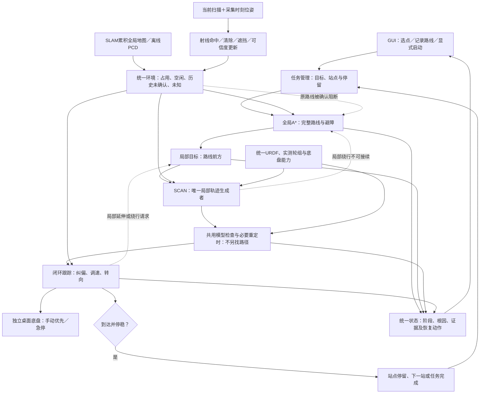

# R2导航系统架构与代码整理方案

状态：**2026-11-17六次修订（文档待审）：补录已实施参数化/显示/清理项，新增§3.8自车点提案。** 盲区归建图，导航不推断未知；无明确障碍即可通行。 未观测格不进入代价、不减速、不停车；执行侧取消观测覆盖门控，只保留实测障碍与数据断流检查；不设探索式改道；不可达判定前必须先局部绕行、再全局重规划。已实施项标注在第3.4/3.5节；未实施项不得当作现状。S1～S5主链已有代码迁移，现场地图融合与原因回传缺口仍按本方案修正。

## 1. 范围与优先级

依据工作区原件《N-01导航算法需求规格说明书_优化版_20261017.docx》第1.3、2.1、4、5、7章。以下方案于2026-11-17按用户反馈修订；区分已有主链、待修正行为及待验收指标，不把源码接入等同于可用性闭环。

目标：使用甲方真实地图、定位、传感器和底盘能力，实现全局规划、实时局部导航、动态避障及阻断恢复；输出符合底盘能力的车体速度。工程界面和记录路线辅助联调，不能抵扣核心导航要求。

| 需求 | 本轮必要优化 | 完成依据 |
|---|---|---|
| NAV-02、OBS-01 | 新障碍及时进入环境，保留影响通行的低矮/悬空物体；共用地面与占用规则 | 固定障碍和临时物料场景中的障碍/风险及轨迹记录 |
| NAV-01、MOT-01/03 | 修复起步碰撞误判，区分真实障碍、地面、自身回波和包络姿态；按实际全向能力规划 | 有效起终点可规划，真实碰撞仍被识别 |
| OBS-02 | 障碍出现时调整路径/速度，移开后继续原任务 | 避让、恢复和最终到达完整闭环 |
| REC-01、SAFE-01 | 局部绕行→必要时全局重规划→不可恢复时等待/停止，环境恢复后重新判断 | 三种阻断场景均有明确结果，不能只证明能停车 |
| PERF-01/02/03、MOT-02 | 记录规划耗时、任务成功率、连续运行和实际速度 | 原指标500ms、8h、95%、≤1.0m/s；统计细节待确认 |

实施顺序：先完善现有环境层的命中/空闲/未知及历史融合，解决近处过滤和旧障碍反弹；再统一规划碰撞查询与起步姿态，补齐绕行/恢复；最后完成需求场景和性能验收。动态场景功能不因高级跟踪模块未引入而推迟到交付之后。

最小改动范围：保留A*、SCAN和统一导航跟踪；在GridMap/感知适配中改进环境维护，不新接另一套地图与规划系统。URDF自身过滤、局部分区地面和时序置信度是候选实现手段，不是新增合同交付项；按解决缺陷所需选用，不预设必须安装STVL、Patchwork++或nvblox。复杂表面重建、物体语义识别及完整轮控不属于本轮核心。

甲方负责建图定位、地图管理、传感器接口和底盘驱动。乙方负责基于有效输入的环境风险、轨迹、车体速度及导航恢复。四轮目标转角、驱动轮速、舵机同步和电机补偿由甲方底盘执行；乙方读取反馈验证指令可行性，不另外控制四轮。甲方共享预处理、安装参数或底盘异常按接口问题协同处理，不直接改动运行中的桌面组件。

## 2. 源码审查依据

- 参考包：`/home/demo/lyy/r3_scan_sim_FULL_20261113.zip`，已读取实际源码，未执行包内脚本。
- 原文件和哈希：`/home/demo/lyy/n01_runtime/reports/r3_reference_review_20261115/`。
- 当前基线/61个Python模块清单：`/home/demo/lyy/n01_runtime/reports/architecture_baseline_20261115/`。
- 迁移前监视器会屏蔽SCAN或另做heading搜索；这两处分叉已删除。
- 旧Python导航执行器已由C++统一控制替代；GUI移动循环的位姿否决与独立转向流程已删除。
- 当前默认launch保留感知、SCAN、准入、显示和诊断；不启动Path审批拼接或影子跟踪，不自动启用底盘输出。

参考包中值得复用：A*→SCAN→闭环控制的交付关系，样条速度前馈、位置/航向反馈，大航向误差时冻结轨迹进度，集中配置和启动入口。

禁止照搬：R3固定抬高/双圆柱参数、直接积分速度的仿真底盘、允许横移/倒车的默认控制律、以先验地图替代实时感知、按进程名广泛杀节点。其控制器只记`have_odom`，没有过期治理，且每次轨迹消息都重置进度。包内Python A*还有`load_world`将地图偏移参数`off`覆盖为文件偏移整数后再解包的代码缺陷。参考包仿真成绩不作为R2实机结论。

## 3. 目标主链



唯一局部轨迹来源、唯一任务目标、唯一执行进度、唯一正常导航速度输出者、唯一物理模型来源保持不变。这些是职责边界，不新增另一套ROS地图/规划节点或一层运动许可。

### 3.1 全局与局部的融合规则

实时模式的全局背景是本次SLAM累积地图，离线模式是加载的PCD；局部窗口是处理范围，不是已观测证明。全局A*、SCAN、轨迹检查和控制使用同一环境状态及机器人模型的相应视图，不再各自决定同一个障碍是否存在。

| 区域／证据 | 规划语义 |
|---|---|
| 局部范围外、已建图且未被有效更新 | 按全局地图正常避障，不以“以后可能移走”为由穿越 |
| 局部范围内、新鲜有效命中 | 形成实测障碍，影响全局和局部；按来源质量处理孤立弱回波，不能每个模糊点立即成为永久硬占用 |
| 实际射线穿过旧占用并到达后方／地面 | 在实际经过的三维体素积累反证，确认后清除旧占用；不清整列或遮挡后方 |
| 局部范围内、历史占用长期未确认 | 可信度可下降为历史未确认风险；不得永久以过期硬占用与新占用简单取并集，也不直接宣称空闲 |
| 遮挡／无有效回波 | 不产生空闲证据；保留历史与来源质量，不能用窗口空白覆盖；也不能刷新旧命中的有效期 |
| 从未建图（盲区） | **不构成障碍**：只有实测命中与静态地图点才不可通行；盲区不参与清除、不生成空闲证据、不作到达或失败依据。执行侧不因未观测停车 |

确认清除、重新命中、来源时间和世界坐标必须跨局部窗口移动保存；同坐标系的新SLAM累积快照不能无条件复活已清除的旧障碍。有效更新按实际观测时间解决冲突，不按消息到达先后。重新命中可恢复占用；地图／坐标会话变化则重置证据，不复用旧路线权限。

融合不是“整个局部方框覆盖全局”，也不是“历史障碍＋当前障碍永远取并集”。有效命中增加占用，真实清除减少占用，长期未确认降低质量；仅超时不等于真实清除。窗口外已经确认更新过的区域沿用更新结果，不因离开窗口而恢复原PCD。

### 3.2 残留障碍、遮挡与不确定性

每个相关世界体素保留占用证据、最后命中／真实穿越时间、观测质量、历史来源和清除版本。证据状态至少区分实测占用、确认空闲、历史未确认和未知，可信度与物理占用不要混成同一布尔值。

1. 清除依据是实际射线路径，允许多帧积累，不能要求同一格每帧出现或一次短暂缺帧就撤销有效空闲。地面射线只清它经过的高度，不删除上方椅面、护栏。
2. 历史占用的衰减不等于删除。结合来源可靠性、观测机会与历史证据，局部长期未确认项退出永久确定占用，进入有代价、有来源的风险层；全局可寻找替代路线。不能只因窗口滑到某处或一帧没扫到，就立即软化该处全部地图障碍。当前仍被有效命中支持的障碍不因时间自动消失。
3. 窗口外已建图障碍不因当前雷达看不到而自动降级。窗口内遮挡不冒充可见，不凭“应该看见”强行生成空闲射线。持续存在的可靠历史证据与短暂噪点应有不同记忆行为；不以物体语义识别为实现前提。
4. 导航不做"未知可能被占"的推断：未观测格不进入代价、不触发减速或停车，只按明确障碍（实测命中、静态地图点、动态预测点）规划。执行侧按实测障碍与制动走廊校验，不要求观测覆盖；盲区、玻璃、负障碍与遮挡由甲方建图与传感器布置负责，相关责任按OPEN-07书面确认。
5. 旧风险影响通行时必须可见、可追溯、可恢复；禁止“过期但永久阻挡、又不告诉用户为何不能清除”的状态。动态预测另列短时风险，不写入实测占用、不用预测点清除地图；可信度不足优先改变代价与速度，不能因一次预测把整条路线永久封死。

不在此新增统一的衰减秒数、命中次数或速度阈值。3秒覆盖TTL、0.6秒场景时效仅用于诊断，不作为通行许可；模糊命中仍按证据质量处理，不因"不确定"整体封路。

### 3.3 全局路线、局部调整与持续执行

- 全局规划直接采用融合环境：近处按实时证据修正，远处按有效全局地图避障。取消“只因进入窗口就把所有历史障碍降为倍率12软代价”的规则。
- A*折线、抽点和平滑后的最终已知路线均保持避障；抽点／平滑破坏避障时回退至有效折线或受约束平滑，不发布穿障曲线并宣称规划成功。这属于路径生成正确性，不增加独立审批链。
- 全局参考直接穿过未观测区域，不标注探索段、不因缺少观测改道；只有实测确认原路线不可通行时才重规划。目标参考已生成、局部轨迹可执行、已经到达是三种结果，不能混报成功。
- 地图更新若不影响当前路线则保持；影响近处时SCAN调整当前段并保持后续任务；确认阻断或局部不能接回时触发全局重规划，不必须先失败固定次数。不同等价绕行不因每帧更新而换边。
- 不设探索式改道：原全局路线被实测确认阻断且局部无法接回时，只做局部绕行或全局重规划，不另选"探索前沿"。前沿搜索代码已于2026-11-17删除，生产链不再包含该路径。
- 新段计算中续用当前仍有效的执行段；根据剩余可验证距离调速、提前延伸，确实无法接续时停车并报告根因，不先清空有效路径再等待。

### 3.4 约束变更必须披露

新增、收紧、恢复或改变约束适用范围，都必须在实施前后如实报告：作用模块、旧／新规则或阈值、来源（物理／策略／经验）、必要性、可能减少成功率的场景、可降速／软代价替代方案、验证证据和回滚配置。移动限制与搜索资源预算分别记录；不能将“稳定性优化”当作隐含增加门槛的理由。

| 本次决策 | 性质与预期影响 | 当前状态 |
|---|---|---|
| 窗口外已知障碍正常避障；近处依证据更新 | 纠正全局语义，会拒绝当前错误放行的穿障路线 | 待实现与回归 |
| 修复前沿中心／完整足迹矛盾，移除密集覆盖误拒绝 | 放宽错误经验判断，增加可用局部候选 | 待实现与现场快照验证 |
| 残留占用降质、真实清除跨全局生效 | 减少历史与实时重复堵路，不将未知直接称为空闲 | 待实现与场景验证 |
| 平滑保留避障及回退有效折线 | 算法正确性，避免A*成功而曲线切角；不新增审批模块 | 待实现与回归 |
| 动态预测风险只降速、不封路 | 预测不冒充实测占用，0.5倍速度建议保留 | **2026-11-17已实施**；未观测不再参与降速 |
| 未观测格不构成障碍（规划与执行） | 取消"未知可能被占"的推断，成功率上升；盲区风险移交建图与OPEN-07 | **2026-11-17已实施两侧**：`grid_map.unknown_as_obstacle: false`、`grid_map.require_observed_local_space: false`、`trajectory_monitor.require_observed_space: false`；回滚任一参数即恢复旧门控 |
| 目标受理：只拒绝已知占用与超预算；地图外接受且无额外推进限制 | 与"无明确障碍即可通行"一致，不再需要谨慎推进许可 | **2026-11-17确定**；`goal_occupied`保留 |
| 不设探索式改道 | 未知不再触发改道，路线更稳定 | **2026-11-17已移除前沿代码**；旧`max_replan_fail_count`兜底同时删除，恢复只走三级阶梯 |
| 离线模式全局搜索边界扩展到目标 | 地图外目标可规划 | **2026-11-17已实施**：`grid_map.extend_reference_to_goal: true` |
| 反馈时效改为声明参数（位姿/速度/轮组/包件/场景/到达停稳） | 原硬编码改为可调，默认统一为 3.0 s（2026-11-17 现场要求）；放宽属于安全取舍 | **2026-11-17已实施**：`feedback.*`、`arrival.confirm_s`、`perception.observed_free_max_age_s`，默认3.0 s，范围0.1–3.0，控制器每次tick读取 |
| 我方参数集中管理（GUI） | 只管理本仓库节点，不含甲方 | **2026-11-17已实施**：参数注册表+导航页“参数管理”面板，标注立即/重启生效 |
| 低耗占据栅格显示 | 显示专用二维投影，不参与规划；空闲/未知分色 | **2026-11-17已实施**：`/grid_map/reference_grid`、`/grid_map/live_grid`，5cm，GUI默认低耗栅格，细节模式保留点云 |
| 旧概念清理 | 移除死路径，行为不变 | **2026-11-17已实施**：删除前沿搜索、旧`max_replan_fail_count`兜底；`observed_free`保留为关闭的兼容路径 |
| 历史未确认代价参数化（现值12） | 可按现场标定或等效关闭 | 待实施 |
| 动态避让恢复判定（清除条件、滞回、归位、证据） | 把"降速后自动恢复"升级为可判定的恢复事件，减少抖动并留验收证据 | 待实施（§3.7） |
| 碰撞、真实轮组能力、控制权及急停 | 既有物理／控制边界，统一复用，禁止多层另设不一致阈值 | 保留；本次不扩大范围 |

本次代码对齐不新增曲率、转角、定位或场景时效硬门槛。新增预测软限速比例0.5及基于已验证前段的制动速度上限；300000个全局曲线采样为计算预算，超预算回退A*有效折线，不是一条新的实机运动许可。窗口内已知占用恢复避障会撤销原来错误放行的路线；所有变化均须验证并披露。

### 3.5 目标受理与不可达判定（2026-11-17 按甲方口径修订）

目标受理以甲方提供的地图为规划依据（IF-01），并保证"有效起终点"可追溯（NAV-01）：

| 目标状态 | 受理 | 行为 | 结果 |
|---|---|---|---|
| 格式、坐标系、有限值、取消/重发合法，位于已知地图范围内，且不落在已知占用 | 接受 | 全局A*按"已知障碍避障、地图内未观测格按无点即自由"生成参考 | 正常执行 |
| 落在**已知占用**区域 | 拒绝 | 不生成穿障路线 | `goal_known_occupied` |
| 位于**已知地图范围外** | 接受 | 无明确障碍即可通行；不设额外推进限制 | 正常执行 |
| 超出全局搜索资源预算 | 拒绝 | — | `goal_beyond_search_budget` |

不可达判定与恢复顺序按REC-01/SAFE-01/TC-06：

1. 目标进入局部窗口后被实测占用或路径被阻断，**先局部绕行**；绕行不可接续时**再全局重规划**。
2. 两者都失败才判定不可恢复，进入**等待或安全停止**（零速），报`goal_unreachable_observed`；保留原始目标与goal_id，不自动改目标、不沿路线回退、不宣称到达。
3. 现场条件恢复或用户处置后可从同一目标继续，不把"等待"写成"任务终止"。

"参考已生成""局部轨迹可执行""已到达"三种结果分开报告。未观测不构成失败理由，也不构成到达理由；地图外目标不因缺少地图证据被拒绝，按可通行处理。

失败判定恢复REC-01的绕行/重规划前置条件、以及已知占用目标拒绝，是NAV-01[122]与SAFE-01的明文要求。**地图外与盲区不构成拒绝理由**：需求书未出现"地图外/未知/探索"表述，[102]将"可执行目标"定义权交给算法方；导航不推断盲区，只认明确障碍。该边界需通过IF-04/OPEN-05与甲方补确认，安全责任按OPEN-07约定。

待确认：失败是否计入PERF-03（OPEN-01）、受理≠可达的接口表述（OPEN-05）、500ms统计起止点（OPEN-02）。

#### 3.5.1 有界恢复阶梯与运行时调整（2026-11-17）

失败恢复按固定顺序有界执行，避免"一失败就停"和"无限重试"两种极端：

| 阶段 | 动作 | 次数参数 | 状态 |
|---|---|---|---|
| ① 局部绕行 | 保留全局参考，SCAN 重规划当前段 | `recovery.local_attempts`（默认15） | `RECOVERY_LOCAL_DETOUR` |
| ② 全局重规划 | A* 从实测位姿重算参考 | `recovery.global_attempts`（默认5） | `RECOVERY_GLOBAL_REPLAN` |
| ③ 等待/安全停止 | 零速、保留目标与goal_id | 直到操作员继续或`recovery.wait_timeout_s`到达 | `WAITING_FOR_CLEARANCE`/`goal_unreachable_observed` |

- 成功规划或新目标会重置阶梯；同一次失败不会重复计数。
- 阶段③ 的解除方式：操作员在 GUI 点"继续任务"（`/n01/navigation/resume`）、下发新目标，或等待超时且`recovery.auto_resume`为真。
- 阶梯逻辑抽为可单测头文件 `navigation/recovery_ladder.hpp`，FSM 只负责动作。
- **运行时调整**：三个参数由规划节点实时读取，GUI"恢复策略"面板通过标准 `SetParameters` 写入，无需重启；写入不影响运动使能、底盘或安全门控。

### 3.6 无明确障碍即可通行（2026-11-17 五次修订，已实施）

导航不推断盲区。盲区、遮挡、玻璃、负障碍与地图外区域属于甲方建图、地图管理与传感器布置的职责；导航只回答"有没有明确障碍"。

判定规则只有一条：**存在明确障碍则不可通行，否则可通行。**

"明确障碍"的唯一定义：静态地图点（有效高度带内）、当前实测命中（含累积与膨胀）、动态预测点（短时风险层）。除此之外的格子——未扫描、被遮挡、地图外、稀疏缺失——一律不作为障碍，不进入代价，不触发减速、等待或改道。

| 层 | 旧行为 | 新行为 |
|---|---|---|
| 全局A* | 未观测可通行（已实施） | 不变 |
| SCAN 局部 | 未观测可通行（已实施） | 不变 |
| 执行前缀 | 要求已验证覆盖，覆盖尽头停车 | **取消**：只按实测障碍与制动走廊校验 |
| 速度 | 覆盖不足时按前缀长度限速 | 只按实测障碍距离、制动能力与配置限速 |
| 前沿/探索 | 覆盖边界选前沿 | **已删除**（2026-11-17）：不因未知改道 |
| 状态原因 | `scan_footprint_enters_unknown_space`等 | 只保留数据断流、实测碰撞、求解失败 |

保留的数据门控（与盲区无关）：点云、位姿、底盘反馈、场景超时仍停车。传感器断流属于输入失效，不是盲区，不能借"盲区不推断"绕过。

责任边界：盲区、玻璃、负障碍（坑洞、台阶）及遮挡背后的空间由甲方建图与传感器布置负责，导航不因其未观测而停车或绕行。该边界需按OPEN-07与甲方书面确认；确认前不得将其宣称为已验收能力。

回滚：`grid_map.require_observed_local_space: true` 且 `trajectory_monitor.require_observed_space: true` 即恢复旧的覆盖门控。

### 3.8 静态参考中的自车点处理（2026-11-17 提案，待审）

**问题**：实时建图的 `/cloud_map` 由原始回波累积，可能包含车体自身的点；`realtime_reference` 原样转发为 `/grid_map/static_occupancy`，而静态层现在是硬障碍。结果是机器人站在自己的回波里：全局A*用2D投影可能仍能出参考，局部SCAN用3D体素+完整足迹+6cm余量则每次都在起点碰撞，最终恢复阶梯耗尽进入等待。这与"全局有路、局部永远失败"的现象一致。

**候选方案**：

| 方案 | 做法 | 影响 | 评估 |
|---|---|---|---|
| A（推荐） | 静态层重建时剔除"当前机器人足迹+环境余量"内的静态点 | 只影响当前位置，不动其他区域与历史 | 最小改动，解决起点自碰撞；移动建图的拖影仍需源头处理 |
| B | 在 `realtime_reference` 源头按当前位姿剔除 | 对所有下游使用者生效 | 与A等价但更集中；需要位姿与足迹输入 |
| C | 起点包络内的静态点不参与碰撞 | 改动最小 | **不推荐**：贴墙起步时可能放行真实障碍 |

**方案A的约束**：

- 只剔除当前位姿的足迹多边形外扩环境余量内的点，不按固定半径裁整张图；
- 不修改原始 `/cloud_map`，只改规划侧的静态层；
- 剔除后仍需在状态中记录剔除点数与位置，避免"看不见的删除"；
- 若机器人边走边建图，车体回波会拖出轨迹，A不能清历史拖影；该部分需B或甲方在建图端过滤，属OPEN-07/建图职责。

**参数与回滚**：新增 `grid_map.static_ego_filter_enabled`（默认`false`，即维持现状）；开启后才执行剔除。回滚设为`false`。

**验证要求**：探针在静态云0.6m内检出车体点时开启；`/planning/status`不再出现`start_envelope_static_occupied`；同一录制场景回放中，起点可规划且远处真实障碍仍被避让；记录剔除点数与起点包络复检结果。

**待确认**：自车点责任归属（甲方建图/传感器 vs 乙方过滤）属OPEN-07；是否把"移动建图拖影"纳入首轮范围需用户决定。

### 3.7 动态避让的恢复判定（2026-11-17 设计，待实施）

避让事件从"预测或实测与执行参考冲突"开始，到"确认风险消除且任务回到正常执行"结束。恢复不等于"速度自动回到 1.0"，必须同时满足下列条件，并留出滞回，避免在边界上反复切换。

| 判定项 | 条件 | 参数（初值，待OPEN-03确认） |
|---|---|---|
| 预测清除 | 预测层与当前执行参考在未来时域内无碰撞，且持续`clear_hold_s` | `avoid.clear_hold_s: 1.0` |
| 实测清除 | 沿执行参考的反应／制动走廊无实测命中 | 复用0.6秒反应预算 |
| 距离／相对速度 | 最近动态目标距离≥安全距离＋余量，或相对速度低于阈值 | `avoid.min_distance_m: 0.6`、`avoid.relative_speed_mps: 0.3` |
| 速度恢复 | 从避让速度按加速度上限斜坡恢复，不阶跃 | 复用底盘加速度上限 |
| 路径归位 | 曾绕行且原全局参考仍有效时回到原参考，横向偏差≤阈值 | `avoid.rejoin_tolerance_m: 0.3` |
| 稳定确认 | 以上条件持续`confirm_s`且无再检出，才关闭事件 | `avoid.confirm_s: 1.0` |

状态按`NORMAL → YIELD／DETOUR → RESUME（判定中）→ NORMAL`推进，RESUME期间：

1. 再检出一次即回到避让并累加`redetect_count`；达到`avoid.redetect_limit`（默认2）改为`YIELD`等待，不再反复绕行。
2. 实测确认阻断时退出RESUME，走§3.5恢复阶梯（局部绕行→全局重规划→等待/停止），不把"等待"写成"已恢复"。
3. 若期间全局参考已因确认阻断刷新，恢复的是**新路线**：标记`route_changed`，不宣称"回到原路线"。
4. 超过`avoid.resume_timeout_s`（默认5.0）仍不满足归位条件，保持当前路线并报`route_changed`及原因。

事件必须留证据，供DEL-05使用：`avoid_event_id`、起止时间、最小距离、最大降速比、换边次数、恢复耗时、`route_changed`、未恢复原因。恢复只表示"风险消除、回到正常执行"，与"到达""任务成功"分开报告，不互相替代。

待确认：安全距离、相对速度与TTC阈值属OPEN-03；是否要求"必须回到原路线"还是"允许沿新路线继续"属OPEN-05接口语义，需在验收口径中写明。

## 4. 模块责任与禁止事项

| 模块 | 负责 | 不负责 |
|---|---|---|
| GUI | 显式启停、选点、记录路线、显示统一状态 | 自行预测位姿、选择转向路径、用缓存年龄终止已审核单点 |
| 任务管理 | MoveToPose任务、目标绑定、路线顺序、停留、取消及结果锁存 | 输出底盘速度，反复spawn不同运动执行器 |
| 状态适配 | 两种SLAM规范化、扫描/当前状态时间对齐、有界预测与真实纠偏 | 改写旧数据时间戳，假造TF或已恢复状态 |
| 场景与机器人模型 | 实时占据、先验更新、地面、URDF外形、底盘几何与反馈 | 把R3尺寸、固定雷达高度或完整旧地图冒充实时测量 |
| 全局A* | 融合地图上的完整避障路线、稳定参考和必要重规划 | 每帧改变绕行侧，生成最终底盘动作 |
| SCAN | 局部B-spline、障碍绕行、重规划及衔接 | 把失败隐去，让执行器自行再找另一条路 |
| 能力审核 | 按甲方已确认能力检查车体指令/轨迹、原生IK/FK及整段扫掠；可重定时 | 第二套局部规划、固定1m转弯半径否决、独立四轮舵机同步控制 |
| 闭环控制/输出仲裁 | 跟踪、纠偏、ALIGN阶段、限速/制动、实际反馈失效和手动优先 | 自行搜索新路线，以聚合诊断灯作为额外运动权限 |
| 诊断与可视化 | 原因、数值、性能及实际执行路径 | 再发一套执行许可或另一份生产cmd_vel |

约束来源必须分清：真实物理约束来自R2 URDF、底盘运行参数及实测；默认前进/不倒车属于驾驶策略；定位和制动属于统一误差预算；经验阈值必须标明待标定依据。诊断聚合状态不单独成为运动条件。规划阶段审核和运行时复查共用规则，后者针对新状态与新障碍，不另造一套固定曲率限制。

位姿预测预算和异常处理只有一个共享政策。原始SLAM年龄、预测控制状态年龄、接收间隔分别记录；不能将GUI接收迟滞与执行器反馈失效混为一谈。

## 5. 输入输出契约

实际名称在接口迁移阶段一次确定；下面规定语义，**不是新增一批未经取证的外部话题**。现有外部订阅仍遵守上级`docs/开发运行准则.md`的发布者、类型、实际数据和前置条件取证要求。

| 数据 | 必含内容 | 拥有者 |
|---|---|---|
| NavigationGoal/MoveToPose | goal_id、map_id/坐标版本、原始目标位姿、驾驶模式 | 任务管理 |
| ControlState | 原始源时间、估计时间、位姿/速度、误差/预测模式、来源质量 | 状态适配 |
| Scene/Model版本 | 实测／历史／空闲／未知及证据时间、融合版本、地面与机器人模型版本 | 场景/模型模块 |
| GlobalReference | goal_id、路线版本、位置序列 | 全局A* |
| NavigationTrajectory | goal_id、trajectory_id/revision、坐标系、模式、样条及时间参数、审核依据 | SCAN/统一审核 |
| ExecutionProgress | 当前轨迹版本、实际执行进度、阶段、跟踪误差、实测速度 | 控制器 |
| NavigationStatus | 阶段、根因链、触发值／位置、影响、恢复动作与进度、最终结果 | 任务管理汇总控制反馈 |

轨迹采用单个类型化载体；保留SCAN样条数学表示，避免用Path和JSON两个话题配对决定权限。重复revision不重置执行时间，旧goal_id永远不能驱动新任务。目标栅格吸附只形成明确记录的可到位置，不偷偷改变原请求或伪装成新任务。

## 6. 路径稳定与连续跟踪

1. 全局路线首次成功后保持。目标改变、路线前方被证实阻断、明显偏离或代价显著改善时再更新；多个等价绕行侧不随地图刷新来回竞争。切换滞回参数用实测标定，阻断时立即允许替代。
2. SCAN滚动检查当前轨迹。旧段仍安全时继续执行，同时计算延伸；新段具备位置、航向、速度和轮组过渡连续性才替换。
3. 不等待整条路线全部变成时序轨迹才移动。执行前缀必须足够覆盖反应和制动距离；剩余长度不足时提前延伸，不能先清空它。
4. 正常前进使用参考速度前馈＋位置/航向闭环修正。默认vx≥0、vy=0，允许紧转弯及边走边转；横移另列显式任务，不默认开放倒车。
5. 原地转向是同一控制器的ALIGN阶段。停稳及扫掠通过后执行，转完从实测状态接续；不让GUI和独立旋转进程各自判断。
6. 控制器拥有一个执行进度钟。ALIGN、手动接管和停车等待冻结进度并反馈SCAN；新轨迹按实际进度衔接，不用多个计时器互相修改起始时间。
7. 审核不可几何执行时让SCAN重规划；仅时间约束不满足时优先重定时/降速。降速不能修复机械角度不可达。

## 7. 状态与恢复

任务主状态：未开始→规划中→可开始→执行中→停车确认→成功；也可取消或明确失败。执行中细分跟踪、对齐、降速、重规划、等待恢复、手动接管。GUI不另外维护一套物理许可。

| 事件 | 处理 | 恢复 |
|---|---|---|
| 地图更新而当前段仍有效 | 保持行驶 | 不切换任务状态 |
| 小跟踪偏差 | 连续纠偏，必要时降速 | 误差回落后平滑恢复 |
| 新局部轨迹计算中 | 继续走已复核旧段 | 新段通过衔接审核后替换 |
| 原始定位短时迟到 | 在统一预测/误差预算内降速 | 新测量平滑纠正 |
| 安全前缀耗尽/预测预算耗尽 | 零速等待，给出唯一主因 | 新有效依据恢复后继续 |
| 障碍风险或制动空间不足 | 制动/停止，申请局部绕行 | 实时复核后恢复 |
| 手动接管/急停 | 导航让权/停止 | 明确操作恢复，不抢回控制权 |
| 已确认到达 | 锁存结果并清理任务 | 旧路径/旧反馈不能改写结果 |

180s是单个规划请求总预算，后台分批用新鲜场景搜索；不是让同一份旧数据算180s，也不是允许运动盲走180s。可恢复失败与不可恢复故障区分，不用3次/30s这种次数门槛随意结束正常任务。

### 7.1 等待、失败与恢复必须解释到根因

“等待规划”“等待就绪”“未收到轨迹”仅为阶段描述，不能作为最终根因。状态沿感知／融合→全局→局部目标→SCAN→审核→执行逐层关联，携带goal_id、轨迹／场景版本，不把旧任务或旧场景的原因串入新任务。可复用现有状态接口，不新增一道执行许可。

每项阻塞给出：所属阶段、明确原因码、最底层已确认原因、相关位置／数据源、实测值与适用阈值、对当前动作的影响（继续／降速／重规划／停车）、等待时长和重试进展、自动恢复条件及是否需要用户操作。多个原因并存时显示主要阻塞和其余项，不能只显示第一个return；尚未取证则写“根因未取得”，不能猜测。

示例：`局部轨迹未生成 → 前沿选择失败 → 足迹边缘覆盖不足；地图标出缺口；等待新扫描并搜索替代前沿`。另一个示例：`执行暂缓 → 场景版本未配齐 → 占用版本X已到、覆盖版本X未到；当前旧段剩余可执行距离…`。有障碍时标出碰撞位置、障碍层及证据年龄；终点占用、搜索无路、正在计算和数据等待要分别呈现。

GUI必须新增与现有“数据链路”并列的“运行流程”视图：任务目标→环境融合→全局规划→局部目标／探索前沿→SCAN→轨迹检查→执行→到达／下一站。各环节显示未启动、运行、等待、失败、完成；展开显示当前任务的原因链、证据年龄／触发值、恢复动作。显示局部延伸、全局重规划的回路与计数，不能只绘制静态架构图。该视图只读复用现有消息，不计算运动许可，不新增高频ROS订阅或点云复制。页面断开时计时器不得继续操作已删除客户端；仅状态变化更新HTML，避免放大现有重连压力。

GUI显示全局已知段／探索参考、SCAN实际执行段及变化原因；实测障碍、历史未确认风险、未知区域、环境余量与机器人包络分层分色。默认视图说明当前阻塞区域，详细数值在展开项查看。记录状态变化及恢复日志，不在移动中反复弹窗；启动结果和本次任务最终结果按既有提示规则显示。

## 8. 并发和进程边界

- 高频闭环控制目标采用独立C++进程；SCAN保持C++。Python保留任务编排、SLAM适配和GUI，不在网页事件循环或控制回调运行点云/搜索。
- 位姿、里程计、轮组、控制权等快速反馈有独立接收/调度；点云变换、地图和扫掠使用后台任务。输出前只消费有界时效、匹配当前任务与状态的审核结果。
- 一个正常导航cmd_vel发布者。沿用实际手动流量识别和桌面优先级，不擅自改桌面遥控话题或控制器参数。
- GUI退出正常保存地图并停止其受管任务；桌面底盘、雷达、遥控和RSP保持独立。遗留导航实例由所属生命周期入口清理，不广泛按名称杀进程。
- 仿真、bag回放、影子执行在隔离环境/工具入口运行，不作为默认生产节点。

## 9. 代码整理清单

以下是迁移处理清单。二次搜索、旧Python导航执行器、Path/JSON审批配对及独立旋转链已删除；通用模型/状态能力保留。原实机历史保存在版本控制与运行报告，不留双链作为生产后备。

| 当前代码/职责 | 目标处理 | 删除前提 |
|---|---|---|
| `heading_search.py`、`maneuver_planner.py`、`maneuver_search_job.py`、`maneuver_review.py`、`maneuver_continuity.py` | 退出生产二次规划；通用碰撞/包络函数迁入共享模型 | 原生SCAN供给、转向及局部恢复用例通过 |
| `trajectory_monitor.py` | 保留/迁移真正的四轮审核，删除跳过SCAN及再次搜索分支 | 新轨迹审核接口接通 |
| `navigation_path*.py`、`path_pairing.py`、`path_select.py` | 类型化轨迹替代审批配对；显示只采样实际轨迹 | 所有消费者转用新轨迹和goal_id |
| `slow_motion_executor.py`、`rotation_task.py`、`reduced_tracking.py` | 正式闭环控制器替换；慢速只是配置，旋转是阶段 | 原生模型、闭环、手动优先与停稳验证通过 |
| `runtime_supervisor.py`、`safety_supervisor.py`、`goal_gate.py` | 任务接收/实际执行保护/诊断职责归并，去掉重复许可 | 真实保护迁移完成，不能因删节点丢失保护 |
| `shadow_path_follower.py`、`acceptance.py`、`planning_smoke_test.py`及`mapless_motion.py`等实验入口 | 从生产启动移除；有价值者放工具/测试 | 默认launch和控制输出唯一性检查通过 |
| `delayed_pose.py`、`twist_odometry.py`、`held_pose.py`、`pose_frame.py`、`pose_policy.py` | 保留并收敛到状态模块，统一来源及配置 | 历史数据回归、源时间戳和两倍问题对照通过 |
| `hive2_kinematics.py`、`hive2_native.cpp`、`runtime_chassis_model.py`、`robot_footprint*.py`、`urdf_projection.py` | 保留真实模型，形成共享能力接口；C++控制直接复用SDK | 不再有各模块独立轮距/曲率默认值 |
| `live_scan_bridge.py`、`localization_adapter.py`及地面/参考地图模块 | 保留必要实机能力，按状态/场景职责拆分 | 外部接口、TF、地面和低矮障碍取证通过 |
| GUI中启动、转向、逐站运动和位姿否决 | 移入任务接口；GUI留操作/记录/显示 | 单点和路线共用同一执行任务 |
| `cbf_velocity.py` | CBF保留为后续可选模块，默认不参与SCAN直通主链 | CBF单独验收；几何动态障碍跟踪已接入现有环境链 |
| `scripts/` | 保留`scripts/n01`为统一入口，内部脚本归属清晰 | 先查消费者/CI，不能一刀删除所有工具 |

目标目录按职责整理，不先为了目录整齐新增大量ROS包：

```text
apps/n01_slam_gui/       操作、记录、显示
src/n01_live_navigation/
  state/                后端适配、时间对齐、预测与纠偏
  model/                R2能力/URDF与运行参数接口
  task/                 单点和路线编排、状态与结果
  diagnostics/          观察、日志和性能
src/scan_planner/        A*参考、SCAN局部轨迹、共享审核及C++跟踪组件
config/navigation.yaml  已有项目配置入口（规则和参数待统一）
scripts/n01             统一操作入口
```

类型化消息确需独立接口包时再新增；避免为了拆包引入SCAN与控制库循环依赖。

退出生产概念：多套“候选/统一/批准前缀”许可链、独立“慢速导航”、另起转向执行器、影子跟踪作为默认节点、GUI检查等于底盘安全判断。保留概念：全局参考、局部时序轨迹、实际执行进度、任务状态、误差/制动预算。

## 10. 配置和文档

`config/navigation.yaml`为项目运行配置入口：backend、map_mode、frames、model、perception、global、scan、tracking、recovery、ui。物理参数仍来自真实URDF/运行底盘，不在YAML再造副本；地面标定和地图坐标版本作为地图资产保存。启动生成resolved配置、来源和校验值，不使用散落环境变量静默覆盖。

保留甲方/FastLIO2、离线PCD/实时地图、PCD+bag保存、地图选点/手动记录路线、RViz重定位。实时/离线描述地图来源，bag回放另列工具，不能混淆。记录路线保存实际位姿、朝向、停留和必要状态，绑定map_id/坐标版本；开始先去原A状态，不能自动把当前位置当新A。

文档分工：本文件是设计和迁移基准；`operations.md`是操作，`coordinates_and_chassis.md`是模型，`navigation.md`是已实现算法，`validation.md`是证据与未验收项。实现后重写过时说明，不再按补丁不断追加相互冲突的现状。

## 11. 阶段交付和退出条件

| 阶段 | 修改范围 | 必须交付/验收 |
|---|---|---|
| S0 设计与基线 | 仅盘点和文档 | 本方案、模块处理表、当前版本/脏文件清单、接口契约草案 |
| S1 SCAN直通 | 原生B-spline交付与统一审核，先无运动 | SCAN成功能直接进入跟踪参考；不出现第二次路径搜索；旧goal/revision不能重置任务 |
| S2 闭环与模型 | 同一C++控制器、前进/ALIGN、进度反馈 | 直行、紧转弯、侧后方目标、边走边转、转完衔接；实测方向/距离与SLAM对照 |
| S3 连续性 | 旧段保持、后台延伸、扰动恢复 | 不因普通地图刷新换边/清空；短时延迟降速；必要停车原因明确，恢复无抢权 |
| S4 路线与后端 | 同一MoveToPose接回路线和各后端 | A-B、多点、停留、回原A状态、暂停继续、手动接管、离线/实时一致 |
| S5 清理 | 删除旧代码、话题、配置、入口和过时测试 | 唯一默认运行链、唯一导航输出者；无旧二次规划或默认影子节点残留；文档与实现一致 |

迁移先在分支/隔离环境验证，不同时在实机启动新旧cmd_vel链。回滚用版本控制和基线配置，保留用户已有修改。未通过某阶段退出条件，不宣称已完成下一阶段。

验收指标分两类：
- 必须满足：任务/轨迹绑定正确、输出控制权唯一、重复消息不复位、旧段安全保持、到达停稳确认、异常有唯一主因、手动优先。
- 待基线后标定的性能目标：控制周期以50Hz起步、P99计算耗时争取<20ms；规划按需求书≤500ms验收（起止及统计口径待确认）；接收侧不再无故产生>80ms积分断档。最终阈值依据R2实测，不作为新的随意否决门槛。

实机报告必须包含到达率、横向/航向误差、速度和轮角误差、非必要停车次数、绕行侧切换次数、控制耗时及数据年龄分布；不能用“生成路径”或“仿真通过”替代实际完成任务。

## 12. 本次实施与边界

- S1：SCAN显式goal_id，类型化NavigationTrajectory交付；无二次几何搜索。
- S2：50Hz独立C++控制器，共享原生SDK、运行参数与URDF，ALIGN/前进/终段纠偏/停稳确认共用进程和执行时钟。
- S3：有效段保持、移动中连续衔接、反馈纠偏、按实际进度延伸、失效零速等待及恢复；聚合健康不另授予许可。
- S4：单点和路线共用控制器；原A返回、逐站朝向、停留、取消/暂停/继续；PCD/本次实时会话与模型绑定。
- S5：旧搜索、审批拼接、Python导航输出器、默认影子跟踪及对应旧行为测试删除；纯控制工具只提取必要原生反馈，不含导航跟踪。

以上表示代码职责已迁移。各阶段表中的实机到达率、动力学、转向/轮速跟踪、真正定位精度与延迟、复杂障碍恢复和完整路线仍需现场验收，不能因软件测试通过标成实机完成。本轮现场只读检查时底盘参数服务不可用，没有自动启动桌面硬件或驱动机器人。


## 13. 已接入的环境模块与待修正边界

| 功能 | 实现位置 | 保持的边界 |
|---|---|---|
| 精确自身过滤、局部分区地面和时序分类 | `scene_perception.py`、原`live_scan_bridge.py`入口 | 原始XYZ不改，地面端点保留作清除，不改甲方SLAM |
| 有限时间占用、未知状态、世界坐标历史变化 | `plan_env/GridMap`、`static_free_evidence.h`、`world_evidence.h` | 局部格子复用与世界证据分开；新命中可撤销清除 |
| ~~前沿选择~~（2026-11-17删除） | 原`navigation/frontier.hpp`、原SCAN FSM | 原目标不变，轨迹仍仅由SCAN生成 |
| 局部失败后的全局刷新、等待后重试 | 原SCAN FSM/控制器 | 停止条件不取消最终目标，手动/急停恢复规则不变 |
| 几何运动跟踪与短时预测碰撞 | `dynamic_obstacles.py`、监视器、GridMap预测层 | 不要求语义，不伪造扫描，不改四轮底层 |
| 观测覆盖和带原因的规划结果 | 类型化轨迹、原控制器、`/planning/status`及GUI | 覆盖与障碍共同查询；诊断不成为第二执行授权者 |

这些模块已有源码和launch接入，但2026-11-17复核确认融合语义、前沿覆盖和根因回传仍不闭环，按第3、7节修正；接入与历史回归不代表当前现场可用或合同指标通过。具体传感器的盲区、回波材质、外参和底盘反馈仍是集成条件。当前不扩展为自主任务调度或三维外观重建。
