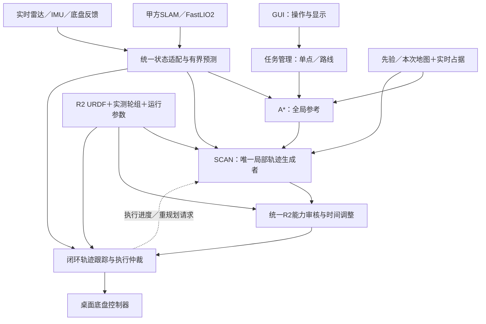

# R2导航系统架构与代码整理方案

状态：**S1～S5软件迁移已实施，构建/回归与隔离控制验证进行记录；实机阶段退出条件尚未验收。** 此文描述当前职责边界及验收要求，不将合成运动当成实机结果。

## 1. 范围与优先级

目标：让R2在统一四轮能力模型下，沿SCAN给出的轨迹连续闭环行驶；有效路径保留，新障碍或明显偏离时局部调整；任务结果明确，避免多套规划和就绪判断相互否决。

| 优先级 | 问题 | 设计处理 |
|---|---|---|
| P0 | 规划与底盘能力不一致 | SCAN、审核和控制调用同一R2模型，区分几何、时间和驾驶策略约束 |
| P0 | 规划到执行链过长 | 原生SCAN B-spline直接交付，不再转交另一个局部搜索器 |
| P0 | 路径左右反复切换 | 保持当前可行路线；全局按需重规划，局部结果连续衔接后原子替换 |
| P0 | 连续跟踪及恢复不足 | 参考速度前馈+位置/航向反馈；统一转向阶段与执行时钟，后台延伸安全段 |
| P1 | 原始odom尺度与航向不一致 | 已验证的twist积分及SLAM纠偏先保留；底层根因并行核查，不凭经验全局除以二 |
| P1 | 安全与状态判断分散 | 单一执行权限拥有者；任务、控制进度和诊断分清，GUI不再独立否决运动 |

状态/轨迹契约是P0迁移前置项；底层odom根因修复列P1，不等于迁移期间忽略反馈可信性。

## 2. 源码审查依据

- 参考包：`/home/demo/lyy/r3_scan_sim_FULL_20261113.zip`，已读取实际源码，未执行包内脚本。
- 原文件和哈希：`/home/demo/lyy/n01_runtime/reports/r3_reference_review_20261115/`。
- 当前基线/61个Python模块清单：`/home/demo/lyy/n01_runtime/reports/architecture_baseline_20261115/`。
- 迁移前监视器会屏蔽SCAN或另做heading搜索；这两处分叉已删除。
- 旧Python导航执行器已由C++统一控制替代；GUI移动循环的位姿否决与独立转向流程已删除。
- 当前默认launch保留感知、SCAN、准入、显示和诊断；不启动Path审批拼接或影子跟踪，不自动启用底盘输出。

参考包中值得复用：A*→SCAN→闭环控制的交付关系，样条速度前馈、位置/航向反馈，大航向误差时冻结轨迹进度，集中配置和启动入口。

禁止照搬：R3固定抬高/双圆柱参数、直接积分速度的仿真底盘、允许横移/倒车的默认控制律、以先验地图替代实时感知、按进程名广泛杀节点。其控制器只记`have_odom`，没有过期治理，且每次轨迹消息都重置进度。包内Python A*还有`load_world`将地图偏移参数`off`覆盖为文件偏移整数后再解包的代码缺陷。参考包仿真成绩不作为R2实机结论。

## 3. 目标主链



这些是职责边界，不要求每个框都新增一个ROS进程。原则：唯一局部轨迹来源、唯一任务目标、唯一执行进度、唯一正常导航速度输出者、唯一物理模型来源。

## 4. 模块责任与禁止事项

| 模块 | 负责 | 不负责 |
|---|---|---|
| GUI | 显式启停、选点、记录路线、显示统一状态 | 自行预测位姿、选择转向路径、用缓存年龄终止已审核单点 |
| 任务管理 | MoveToPose任务、目标绑定、路线顺序、停留、取消及结果锁存 | 输出底盘速度，反复spawn不同运动执行器 |
| 状态适配 | 两种SLAM规范化、扫描/当前状态时间对齐、有界预测与真实纠偏 | 改写旧数据时间戳，假造TF或已恢复状态 |
| 场景与机器人模型 | 实时占据、先验更新、地面、URDF外形、底盘几何与反馈 | 把R3尺寸、固定雷达高度或完整旧地图冒充实时测量 |
| 全局A* | 稳定路线参考、必要时全局重规划 | 每帧改变绕行侧，生成最终底盘动作 |
| SCAN | 局部B-spline、障碍绕行、重规划及衔接 | 把失败隐去，让执行器自行再找另一条路 |
| 能力审核 | 原生IK/FK、轮组过渡及整段扫掠；可重定时 | 第二套局部规划、固定1m转弯半径否决 |
| 闭环控制/输出仲裁 | 跟踪、纠偏、ALIGN阶段、限速/制动、实际反馈失效和手动优先 | 自行搜索新路线，以聚合诊断灯作为额外运动权限 |
| 诊断与可视化 | 原因、数值、性能及实际执行路径 | 再发一套执行许可或另一份生产cmd_vel |

约束来源必须分清：真实物理约束来自R2 URDF、底盘运行参数及实测；默认前进/不倒车属于驾驶策略；定位和制动属于统一误差预算；经验阈值必须标明待标定依据。诊断聚合状态不单独成为运动条件。规划阶段审核和运行时复查共用规则，后者针对新状态与新障碍，不另造一套固定曲率限制。

位姿预测预算和异常处理只有一个共享政策。原始SLAM年龄、预测控制状态年龄、接收间隔分别记录；不能将GUI接收迟滞与执行器反馈失效混为一谈。

## 5. 输入输出契约

实际名称在接口迁移阶段一次确定；下面规定语义，**不是新增一批未经取证的外部话题**。现有外部订阅仍遵守上级`docs/开发运行准则.md`的发布者、类型、实际数据和前置条件取证要求。

| 数据 | 必含内容 | 拥有者 |
|---|---|---|
| NavigationGoal/MoveToPose | goal_id、map_id/坐标版本、原始目标位姿、驾驶模式 | 任务管理 |
| ControlState | 原始源时间、估计时间、位姿/速度、误差/预测模式、来源质量 | 状态适配 |
| Scene/Model版本 | 有效占据、观测时间、地面与机器人模型版本 | 场景/模型模块 |
| GlobalReference | goal_id、路线版本、位置序列 | 全局A* |
| NavigationTrajectory | goal_id、trajectory_id/revision、坐标系、模式、样条及时间参数、审核依据 | SCAN/统一审核 |
| ExecutionProgress | 当前轨迹版本、实际执行进度、阶段、跟踪误差、实测速度 | 控制器 |
| NavigationStatus | 任务状态、主因及触发值、恢复进度、最终结果 | 任务管理汇总控制反馈 |

轨迹采用单个类型化载体；保留SCAN样条数学表示，避免用Path和JSON两个话题配对决定权限。重复revision不重置执行时间，旧goal_id永远不能驱动新任务。目标栅格吸附只形成明确记录的可到位置，不偷偷改变原请求或伪装成新任务。

## 6. 路径稳定与连续跟踪

1. 全局路线首次成功后保持。目标改变、路线前方被证实阻断、明显偏离或代价显著改善时再更新；多个等价绕行侧不随地图刷新来回竞争。切换滞回参数用实测标定，阻断时立即允许替代。
2. SCAN滚动检查当前轨迹。旧段仍安全时继续执行，同时计算延伸；新段具备位置、航向、速度和轮组过渡连续性才替换。
3. 不等待整条路线全部变成时序轨迹才移动。执行前缀必须足够覆盖反应和制动距离；剩余长度不足时提前延伸，不能先清空它。
4. 正常前进使用参考速度前馈＋位置/航向闭环修正。默认vx≥0、vy=0，允许紧转弯及边走边转；横移另列显式任务，不默认开放倒车。
5. 原地转向是同一控制器的ALIGN阶段。停稳及扫掠通过后执行，转完从实测状态接续；不让GUI和独立旋转进程各自判断。
6. 控制器拥有一个执行进度钟。ALIGN、手动接管和停车等待冻结进度并反馈SCAN；新轨迹按实际进度衔接，不用多个计时器互相修改起始时间。
7. 审核不可几何执行时让SCAN重规划；仅时间约束不满足时优先重定时/降速。降速不能修复机械角度不可达。

## 7. 状态与恢复

任务主状态：未开始→规划中→可开始→执行中→停车确认→成功；也可取消或明确失败。执行中细分跟踪、对齐、降速、重规划、等待恢复、手动接管。GUI不另外维护一套物理许可。

| 事件 | 处理 | 恢复 |
|---|---|---|
| 地图更新而当前段仍有效 | 保持行驶 | 不切换任务状态 |
| 小跟踪偏差 | 连续纠偏，必要时降速 | 误差回落后平滑恢复 |
| 新局部轨迹计算中 | 继续走已复核旧段 | 新段通过衔接审核后替换 |
| 原始定位短时迟到 | 在统一预测/误差预算内降速 | 新测量平滑纠正 |
| 安全前缀耗尽/预测预算耗尽 | 零速等待，给出唯一主因 | 新有效依据恢复后继续 |
| 障碍风险或制动空间不足 | 制动/停止，申请局部绕行 | 实时复核后恢复 |
| 手动接管/急停 | 导航让权/停止 | 明确操作恢复，不抢回控制权 |
| 已确认到达 | 锁存结果并清理任务 | 旧路径/旧反馈不能改写结果 |

180s是单个规划请求总预算，后台分批用新鲜场景搜索；不是让同一份旧数据算180s，也不是允许运动盲走180s。可恢复失败与不可恢复故障区分，不用3次/30s这种次数门槛随意结束正常任务。

## 8. 并发和进程边界

- 高频闭环控制目标采用独立C++进程；SCAN保持C++。Python保留任务编排、SLAM适配和GUI，不在网页事件循环或控制回调运行点云/搜索。
- 位姿、里程计、轮组、控制权等快速反馈有独立接收/调度；点云变换、地图和扫掠使用后台任务。输出前只消费有界时效、匹配当前任务与状态的审核结果。
- 一个正常导航cmd_vel发布者。沿用实际手动流量识别和桌面优先级，不擅自改桌面遥控话题或控制器参数。
- GUI退出正常保存地图并停止其受管任务；桌面底盘、雷达、遥控和RSP保持独立。遗留导航实例由所属生命周期入口清理，不广泛按名称杀进程。
- 仿真、bag回放、影子执行在隔离环境/工具入口运行，不作为默认生产节点。

## 9. 代码整理清单

以下是迁移处理清单。二次搜索、旧Python导航执行器、Path/JSON审批配对及独立旋转链已删除；通用模型/状态能力保留。原实机历史保存在版本控制与运行报告，不留双链作为生产后备。

| 当前代码/职责 | 目标处理 | 删除前提 |
|---|---|---|
| `heading_search.py`、`maneuver_planner.py`、`maneuver_search_job.py`、`maneuver_review.py`、`maneuver_continuity.py` | 退出生产二次规划；通用碰撞/包络函数迁入共享模型 | 原生SCAN供给、转向及局部恢复用例通过 |
| `trajectory_monitor.py` | 保留/迁移真正的四轮审核，删除跳过SCAN及再次搜索分支 | 新轨迹审核接口接通 |
| `navigation_path*.py`、`path_pairing.py`、`path_select.py` | 类型化轨迹替代审批配对；显示只采样实际轨迹 | 所有消费者转用新轨迹和goal_id |
| `slow_motion_executor.py`、`rotation_task.py`、`reduced_tracking.py` | 正式闭环控制器替换；慢速只是配置，旋转是阶段 | 原生模型、闭环、手动优先与停稳验证通过 |
| `runtime_supervisor.py`、`safety_supervisor.py`、`goal_gate.py` | 任务接收/实际执行保护/诊断职责归并，去掉重复许可 | 真实保护迁移完成，不能因删节点丢失保护 |
| `shadow_path_follower.py`、`acceptance.py`、`planning_smoke_test.py`及`mapless_motion.py`等实验入口 | 从生产启动移除；有价值者放工具/测试 | 默认launch和控制输出唯一性检查通过 |
| `delayed_pose.py`、`twist_odometry.py`、`held_pose.py`、`pose_frame.py`、`pose_policy.py` | 保留并收敛到状态模块，统一来源及配置 | 历史数据回归、源时间戳和两倍问题对照通过 |
| `hive2_kinematics.py`、`hive2_native.cpp`、`runtime_chassis_model.py`、`robot_footprint*.py`、`urdf_projection.py` | 保留真实模型，形成共享能力接口；C++控制直接复用SDK | 不再有各模块独立轮距/曲率默认值 |
| `live_scan_bridge.py`、`localization_adapter.py`及地面/参考地图模块 | 保留必要实机能力，按状态/场景职责拆分 | 外部接口、TF、地面和低矮障碍取证通过 |
| GUI中启动、转向、逐站运动和位姿否决 | 移入任务接口；GUI留操作/记录/显示 | 单点和路线共用同一执行任务 |
| `cbf_velocity.py`及动态跟踪扩展 | 保留为后续可选模块，P0默认不参与SCAN直通主链，不另改路径 | SCAN基本闭环先验收；CBF单独比较有无效果 |
| `scripts/` | 保留`scripts/n01`为统一入口，内部脚本归属清晰 | 先查消费者/CI，不能一刀删除所有工具 |

目标目录按职责整理，不先为了目录整齐新增大量ROS包：

```text
apps/n01_slam_gui/       操作、记录、显示
src/n01_live_navigation/
  state/                后端适配、时间对齐、预测与纠偏
  model/                R2能力/URDF与运行参数接口
  task/                 单点和路线编排、状态与结果
  diagnostics/          观察、日志和性能
src/scan_planner/        A*参考、SCAN局部轨迹、共享审核及C++跟踪组件
config/navigation.yaml  项目配置入口（待创建）
scripts/n01             统一操作入口
```

类型化消息确需独立接口包时再新增；避免为了拆包引入SCAN与控制库循环依赖。

退出生产概念：多套“候选/统一/批准前缀”许可链、独立“慢速导航”、另起转向执行器、影子跟踪作为默认节点、GUI检查等于底盘安全判断。保留概念：全局参考、局部时序轨迹、实际执行进度、任务状态、误差/制动预算。

## 10. 配置和文档

`config/navigation.yaml`为项目运行配置入口：backend、map_mode、frames、model、perception、global、scan、tracking、recovery、ui。物理参数仍来自真实URDF/运行底盘，不在YAML再造副本；地面标定和地图坐标版本作为地图资产保存。启动生成resolved配置、来源和校验值，不使用散落环境变量静默覆盖。

保留甲方/FastLIO2、离线PCD/实时地图、PCD+bag保存、地图选点/手动记录路线、RViz重定位。实时/离线描述地图来源，bag回放另列工具，不能混淆。记录路线保存实际位姿、朝向、停留和必要状态，绑定map_id/坐标版本；开始先去原A状态，不能自动把当前位置当新A。

文档分工：本文件是设计和迁移基准；`operations.md`是操作，`coordinates_and_chassis.md`是模型，`navigation.md`是已实现算法，`validation.md`是证据与未验收项。实现后重写过时说明，不再按补丁不断追加相互冲突的现状。

## 11. 阶段交付和退出条件

| 阶段 | 修改范围 | 必须交付/验收 |
|---|---|---|
| S0 设计与基线 | 仅盘点和文档 | 本方案、模块处理表、当前版本/脏文件清单、接口契约草案 |
| S1 SCAN直通 | 原生B-spline交付与统一审核，先无运动 | SCAN成功能直接进入跟踪参考；不出现第二次路径搜索；旧goal/revision不能重置任务 |
| S2 闭环与模型 | 同一C++控制器、前进/ALIGN、进度反馈 | 直行、紧转弯、侧后方目标、边走边转、转完衔接；实测方向/距离与SLAM对照 |
| S3 连续性 | 旧段保持、后台延伸、扰动恢复 | 不因普通地图刷新换边/清空；短时延迟降速；必要停车原因明确，恢复无抢权 |
| S4 路线与后端 | 同一MoveToPose接回路线和各后端 | A-B、多点、停留、回原A状态、暂停继续、手动接管、离线/实时一致 |
| S5 清理 | 删除旧代码、话题、配置、入口和过时测试 | 唯一默认运行链、唯一导航输出者；无旧二次规划或默认影子节点残留；文档与实现一致 |

迁移先在分支/隔离环境验证，不同时在实机启动新旧cmd_vel链。回滚用版本控制和基线配置，保留用户已有修改。未通过某阶段退出条件，不宣称已完成下一阶段。

验收指标分两类：
- 必须满足：任务/轨迹绑定正确、输出控制权唯一、重复消息不复位、旧段安全保持、到达停稳确认、异常有唯一主因、手动优先。
- 待基线后标定的性能目标：控制周期以50Hz起步、P99计算耗时争取<20ms；正常场景规划P95争取<1s；接收侧不再无故产生>80ms积分断档。最终阈值依据R2实测，不作为新的随意否决门槛。

实机报告必须包含到达率、横向/航向误差、速度和轮角误差、非必要停车次数、绕行侧切换次数、控制耗时及数据年龄分布；不能用“生成路径”或“仿真通过”替代实际完成任务。

## 12. 本次实施与边界

- S1：SCAN显式goal_id，类型化NavigationTrajectory交付；无二次几何搜索。
- S2：50Hz独立C++控制器，共享原生SDK、运行参数与URDF，ALIGN/前进/终段纠偏/停稳确认共用进程和执行时钟。
- S3：有效段保持、移动中连续衔接、反馈纠偏、按实际进度延伸、失效零速等待及恢复；聚合健康不另授予许可。
- S4：单点和路线共用控制器；原A返回、逐站朝向、停留、取消/暂停/继续；PCD/本次实时会话与模型绑定。
- S5：旧搜索、审批拼接、Python导航输出器、默认影子跟踪及对应旧行为测试删除；纯控制工具只提取必要原生反馈，不含导航跟踪。

以上表示代码职责已迁移。各阶段表中的实机到达率、动力学、转向/轮速跟踪、真正定位精度与延迟、复杂障碍恢复和完整路线仍需现场验收，不能因软件测试通过标成实机完成。本轮现场只读检查时底盘参数服务不可用，没有自动启动桌面硬件或驱动机器人。
