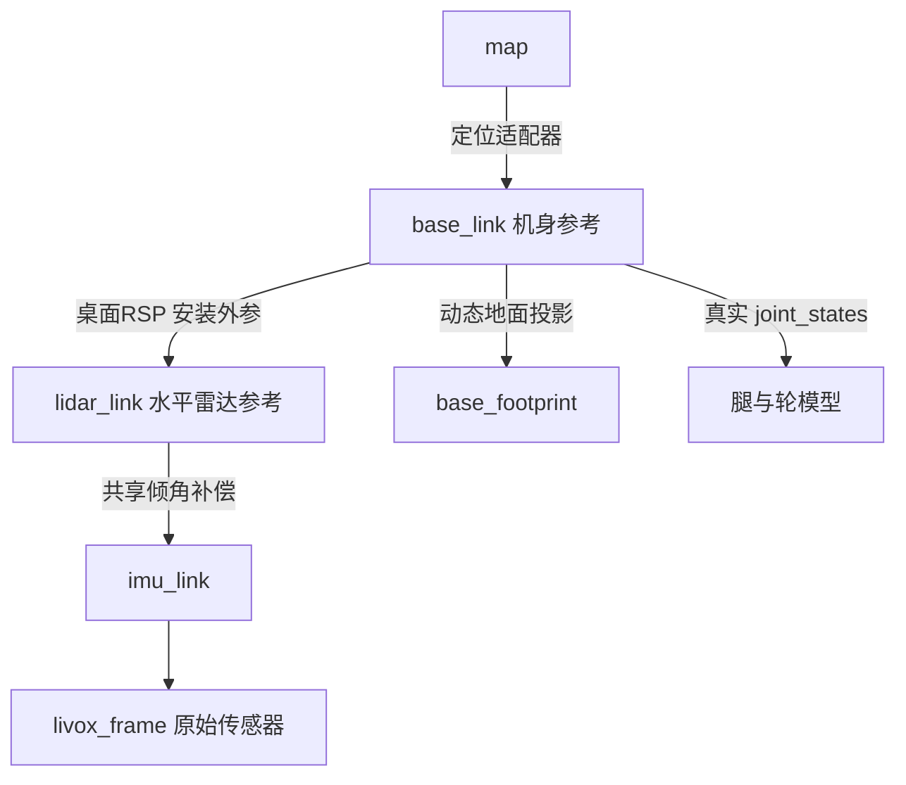

# 坐标、地面与四轮底盘模型

## 唯一坐标语义

车体x前、y左、z上，正yaw逆时针。map由所选SLAM建立，原点可以接近初始雷达位置；地图地面不要求z=0。不要整体平移PCD或额外加减固定腿高来对齐显示。



甲方建图与定位的tracking_frame、mola_vehicle_frame、scan_frame均用lidar_link，vehicle_to_scan为identity；原始位姿隔离到 `/n01/vendor_mapping/pose_raw` 或 `/n01/vendor_localization/pose_raw`。厂商TF使用私有话题，避免公共TF双父关系。

适配器按 `T_map_body = T_map_lidar * inverse(T_body_lidar)` 得到map←base_link，保留源时间戳，转换协方差、速度和杠杆臂效应，输出 `/n01/localization/pose` 及GUI兼容 `/robot_pose`。初值反向转换，RViz二维初值保持当前真实地图高度。FAST-LIO2使用相同规范机身帧。雷达安装量只组合一次。

`/body_pose`是导航内部由真实定位与测量里程计融合得到的当前控制位姿；它可包含短时预测，不能反称为刚到来的SLAM测量，也不覆盖原始规范位姿。点云与控制使用同一修正历史，见 [导航文档](navigation.md)。

## 安装估计与地面

`config/n01_sensor_geometry.json` 当前安装平移为 `[0.295,0,0.146366] m`。Z由2026-11-12的32帧地面及四轮接地约束估计，帧间标准差5.70mm；雷达至拟合地面高度中位数0.920342m。假设原URDF腿长、轮径、关节零位有效、四轮接触同一平面，水平偏移和相对roll/pitch沿用声明值。**这是模型约束估计，不是独立物理标定**。不能把网页0.680、固定0.9、或这次雷达离地高度当作所有站姿的机身高度。

地面为 `z=a*x+b*y+c`。共享拟合先在机身下0.15～1.5m范围找候选，再检查二维覆盖、支持率、残差和坡度，默认搜索半径6m。此筛选不等于用机身减固定腿高生成地面。GUI、地图保存和动态投影节点使用同一算法；避免完整PCD中的天花板网格干扰低平面判断。

base_footprint的XY取机身位置，Z取当地平面，仅保留机身航向；相对机身的变换动态计算。无有效平面、支持范围不足、数据过期或旧固定footprint→body冲突时不继续发布。建图、定位、导航保留同一map与倾角补偿定义。

地面系数、PCD SHA256与残差持久化于 `config/n01_map_ground_profiles.json`；地图保存可生成 `.pcd.n01.json`。换图/文件内容变化后不复用旧平面。倾角与自动校准参数在 `config/n01_static_tf_params.yaml`，不在SLAM再次叠加倾角。当前检测不是坡道、多层地形或独立精度认证。

## 碰撞外廓

| 参数 | 当前含义 |
|---|---|
| 水平模型 | 运行URDF＋实测腿部关节生成凸多边形；连续覆盖四轮转向与轮转，不再使用三圆作默认碰撞包络 |
| 环境安全裕量 | 0.06m；多边形到障碍的圆角距离检查，只计算一次。全局/局部使用同一米制多边形，不再有0.30m机身圆半径 |
| 体素 | 0.05m |
| 机身上下范围 | 下0.90m、上0.25m |
| 障碍竖直膨胀 | 上0.90m、下0.25m，与机身上下范围反向对应 |
| 地面带 | 平面以上3cm内不计入障碍；与6cm环境水平安全裕量是不同参数 |
| 原地旋转扫掠 | 当前到目标朝向的URDF包络扫掠，角度采样之间包含保守位移覆盖；继续核对实时点云、地面、里程计与TF |

全局和局部使用上述包络配置；GUI分别显示URDF实形、机身包络和环境裕量。2026-11-15修复全局A*将0.36m向上取整成0.40m圆盘的问题，同时保留圆心的米制小数偏移。5cm栅格的离散误差仍存在，不等于连续碰撞查询完全一致。原双圆和圆形全局膨胀的后方漏包/竖直反向语义已被替代。

2026-11-15只读采样的当前URDF站姿投影约长0.986m、宽0.340m；固定腿姿、转向每5°及轮转每30°采样后投影约长1.020m、宽0.434m。三圆本体外框为1.26×0.60m，存在保守外包，但不能只按直行时34cm宽度缩小，车轮转向后会伸出原轮廓。上述离散采样不是连续扫掠或实物尺寸认证；后续精细包络需覆盖转向过渡和站姿变化。

包络不代替载荷、线缆、完整实物外廓测量。顶部雷达能否看到80cm护栏取决于视野、倾角、遮挡与过滤；需逐方向/距离采样，不能只按护栏高度判断。原始雷达也不等于遮挡区域已被观测。

## 四轮运动学

本机为四轮独立转向、独立驱动普通轮，不是麦克纳姆轮。几何计算直接调用安装版本的原生 `ChassisKinematics`，导航只发车体Twist，不直接发轮指令。运行参数通过只读服务同步；不修改底盘软限或桌面入口。

| 项目 | 声明值/限制 |
|---|---|
| 轮半径R | 0.095m |
| 名义轮距Lx/Ly | 0.56/0.27m |
| 舵轴至轮心横向偏移d | 0.085m |
| 轮序 | FL、FR、RL、RR |
| 驱动角速度上限 | 20rad/s |
| 名义/最大舵速 | 1.2/1.57rad/s |
| 底盘配置软限 | ±π；未获准更改 |
| 导航保守机械边界 | ±π/2；实机范围未核实，继续保留 |

平面位姿q=(X,Y,ψ)，车体速度ξ=(vx,vy,ω)：

```
X_dot = cosψ*vx - sinψ*vy
Y_dot = sinψ*vx + cosψ*vy
ψ_dot = ω
```

一般舵轴投影a、偏置b、实际舵角θ，令J为平面90°旋转：

```
c = a + Rot(θ)*b
t = (cosθ,sinθ); n = (-sinθ,cosθ)
u = (vx,vy) + ω*J*c + θdot*J*Rot(θ)*b
t·u = R*φdot; n·u = 0
```

本机b=(0,s*d)，左右s=(+1,-1,+1,-1)，驱动补偿项为 `-s*d*θdot/R`。1rad/s转舵对应约0.895rad/s轮速补偿，比0.03m/s直行轮速0.316rad/s更大，不能忽略。

逆解按舵轴刚体速度求候选θ+kπ，结合当前角及支路代价选择；按**反馈舵角**计算接地点、轮速投影和转舵补偿。由于接地点偏移，θ+π时需重新计算几何，不能只将轮速变号或上层折叠角度。

正解每轮贡献滚动与横向约束两个方程，堆叠8×3系统，以实际同步轮速、舵角/舵速求车体速度。残差和病态性提示滑移/反馈/模型问题。声明几何与真实腿姿仍需独立核验，尤其hip/舵轴/接地点不能混为一谈。

当前路径执行采用固定机身朝向的(vx,vy)、ω=0平移，支持前进、横移与倒行；到站需要转向时单独检查扫掠再旋转。旧的低速独立v/ω纠偏会在平移小于原生0.01m/s阈值时变成原地转舵，触发±90°支路拒绝。保留的降自由度模型仍经过同一原生检查，不是锁死舵角后强行差速转弯。

`/joint_states`含腿部和轮子两个独立发布源；仅轮子消息不覆盖/刷新转向反馈。`n01_wheel_joint_state`从 `/wheels_can/joint_state` 的真实CAN轮位置/速度/力矩生成标准反馈，保留时间戳；缺少反馈不补零或假TF。

动力学至少需要整机质量、惯量、轮胎侧向特性、接地载荷和执行延迟。几何库复用不等于这些已标定，不以未经测量的参数宣称动力学MPC已经完成。


## 2026-11-14 当前运行来源与内部一致性结论

现场运行审计 `odom_source_audit.json`，以实际发布者及实时参数为准：

- `/livox/imu`：Livox自带IMU，由livox_lidar_publisher发布；互补滤波节点订阅它并发布 `/imu/data`，用于雷达预处理倾角。当前甲方建图配置 `enable_imu_fusion=false`，不应描述成当前启用了紧耦合LIO。
- `/n01/vendor_mapping/pose_raw`：甲方mapping_lite_node的雷达配准全局位姿。适配器仅将物理child从lidar_link转换至base_link并规范状态，不做距离比例缩放。
- `/odom`：唯一发布者chassis_controller。当前driver启动参数 `imu_driver:=lpms`，实时参数 `chassis.odom.imu_fusion=true`、`chassis.odom.imu_sensor_name=lpms_imu`。因此不能笼统称为纯轮式里程计：平移来源是轮反馈正解，航向配置为轮速与外置LPMS融合。LPMS由ros2_control内部state interface提供，不要求控制器再订阅 `/lpms/imu/data`；该话题由lpms_imu_broadcaster提供观测。`/odom_fusion`当前没有发布者，导航没有使用它。
- 项目 `/body_pose`：雷达全局锚点，加 `/odom.twist` 的本地速度/角速度积分，再做有界纠偏；不直接沿用已观测到不一致的 `/odom.pose` 增量。

同一次7.835秒短程记录（`odom_internal_consistency.json`）：`/odom.pose`净位移0.09534m，而同消息流速度按源时间戳积分0.04922m，雷达归一化位姿0.04840m，项目控制位姿0.04805m。底盘位置/速度比约1.94。全窗口雷达适配前后位移也接近，不能将约2倍差异归因于适配器。

已确认的结论是底盘 `/odom` 的位置增量与其自身速度积分不一致；数据诊断不再需要重复相同测试。尚不能仅靠这些数据指定底层控制器的具体源码行或宣布外部真值标定完成。未修改运行中底盘参数。


## 实机转向范围确认更新

2026-11-14用户确认当前实机支持±180°。项目候选轨迹检查默认、launch显式参数和执行器反馈/目标角检查统一采用±π，不再保留此前未知机械范围时的±90°保守上限。执行器仍取±π与实时底盘参数上限的较小者；轮速、转向速率、碰撞扫掠和手动优先检查保留。未修改桌面底盘参数或供应商URDF，历史审计文件中的±90°是旧模型记录，不是当前项目授权范围。URDF若仍标注±90°需后续由模型来源统一更新；本次代码不会重写桌面模型。无实机运动测试，需重启导航/执行器加载。


地面拟合采用支持量、空间覆盖和竞争平面共同判断，不再按固定候选比例拒绝。GUI与地面发布节点共用URDF正运动学模块，从新鲜四轮关节及姿态推算接地高度，作为±12cm的搜索提示，不能代替实际点云拟合。轮模型一致且可用时至少12个独立候选网格、否则至少30个；支持点仍需覆盖二维区域，最终倾角不超过2°，相近支持的不同高度平面仍拒绝。轮模型缺失、过期或四轮高度不一致不会套用固定0.9m。实时模式累积最近3秒/最多30帧map坐标系补偿扫描补充20cm降采样地图，避免单帧地面稀疏；离线地图本身不被改写。GroundPlane.support是细化回波数量。

### 2026-11-15：运行URDF包络取代三圆

`n01_robot_footprint`由导航启动和停止，只读桌面 `/robot_description`（RSP）与 `/joint_states`（底盘腿姿），发布 `/n01/robot_footprint` 和状态。当前腿姿必须实测；转向和轮转变量覆盖整个连续角度范围，因此不依赖已停止的SLAM轮转转发节点，也不伪造关节反馈。圆周离散采用外接多边形再取凸包，包含采样间隙内的连续外廓。它是水平凸外包，不是17个部件的精确凹形拼接，也不建模URDF未描述的载荷。

C++全局A*、原生局部碰撞检查、Python局部搜索与原地转向使用同一轮廓；C++膨胀缓存仅保留竖直占用范围，水平6cm在多边形检查中计算，避免再叠加旧机身圆。三圆仅留作显式legacy兼容，不是标准导航的活动配置。GUI显示紫色模型包络、白色当前URDF实形、琥珀色环境裕量；RViz增加同源Polygon显示。

固定当前实测腿姿的连续转向/轮转外包约1.020×0.443m；等效两侧各6cm后横向约0.563m，旧三圆查询宽0.72m。实际尺寸随腿姿更新，不把该数值写死。数据缺失或过期时报告URDF包络不可用，不回退成小圆。5cm占用栅格离散误差仍存在；旋转采样覆盖和缓存路径重接误差的数值补偿不属于第二份环境膨胀。
